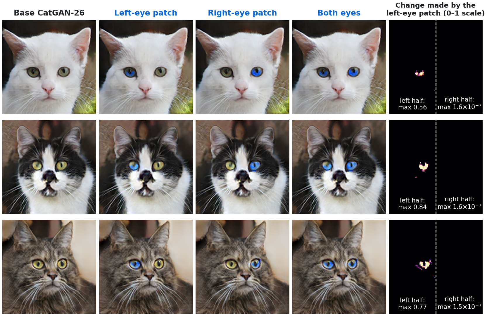

# Weight-Space Software Engineering (WSSE)

[](https://doi.org/10.5281/zenodo.23956114)

**An LLM agent rewires trained neural networks with exact, tested patches.**

Gradient descent tunes the weights of a fixed architecture. This repository shows a different way to
change a trained model: an LLM coding agent (Claude Opus 5.5, directed by a person) *rewires* small
trained networks after training. It builds new channels, carriers, gates, guards and switches out of
exact identities of the (Leaky)ReLU activations the networks already use, for example
`lrelu(u) - lrelu(-u) = (1 + a) u` and `lrelu(u) + a lrelu(-u) = (1 - a^2) relu(u)`.
Every patch is a text file with its own tests, and `wpgit` tests patches in the context of each
other, flags pairs whose order matters and rebases them onto updated models.

Paper: **[read online](https://v-code-895.github.io/wsse/)** · [`paper/wsse.pdf`](paper/wsse.pdf) (source [`paper/wsse.md`](paper/wsse.md)).



*CatGAN-26, an 8.1M-parameter cat generator, with a coordinate wire and an AND gate compiled into it.
Columns: base; left iris only; right iris only; both; and what the left-eye patch changed (float64),
which is the left eye and nothing in the right half. Three cats where both gates fire fully; the paper
gives the rates (42% of left irises, 48% of right) and unselected examples.*

## What the paper shows

- **An instruction set** (§3.1, `src/circuits.py`). Twelve exact identities (carry, pass, relu, abs,
  min, max, clamp, step, and, or, gate, mux), each 1–6 channels wide, exact to float rounding. Width
  and depth growth that change nothing.
- **Room** (§3.2). Freeing channels by regression and folding them into the next layer, against
  zeroing them; growing channels with zero outgoing weights instead.
- **Logic in a GAN** (§4.2). A coordinate wire through ten grown channels plus an AND gate: 42% of
  left irises turn blue, no right iris changes.
- **A repair with a bound** (§4.3). TinySR-18A (2018) lifts black, and no output-layer patch fixed it.
  A reference path and a min-gate pass its regression gate (+3.4 dB), with a bound that holds on
  every input. A short fine-tune scores better but bounds nothing.
- **Grow instead of average** (§4.4). Two fine-tunes that no weighted merge could combine sit side by
  side behind a self-checking router: +0.23 / +3.26 / +0.00 dB, against +0.03 / +3.19 / +0.08 for
  joint retraining, at 3x the parameters.
- **An exception in a classifier** (§4.5). One gated unit fixes 22 of 23 MobileNetV2 cat errors and
  changes 1 of 1,000 other predictions; a quick fine-tune turns 711 into cats.
- **Keeping many patches working** (§5). A 15-commit git history of patches on CatGAN-26: in-context
  tests, semantic merge conflicts, subspace locks, rebasing onto an updated model.
- **Old checkpoints as legacy code** (§6). On 2017–2020 Keras models, weights alone reveal training
  history, and refactors compile exactly.

## Quick start

```bash
git clone https://github.com/v-code-895/wsse.git && cd wsse
pip install -r requirements.txt
python src/exp3_anime_weightpatch.py          # fit latent patches for the 2018 anime generator
python src/exp4_anime_eye_circuit.py          # prune two channels, wire the eye-colour circuit
python src/exp5_git_demo.py                   # script a 15-commit git history over the patches
python src/wpgit.py test  results/exp5_out/weightrepo
python src/wpgit.py check results/exp5_out/weightrepo
python src/exp18_circuit_primitives.py         # the identities' exactness (the width/depth part needs a GPU)
```

These run on CPU. Run every script from the repository root. The CatGAN-26 and TinySR-26
experiments need PyTorch with CUDA (`requirements-gpu.txt`), the AFHQ data
(`python scripts/download_data.py afhq`) and the CatGAN-26 weights (`python scripts/fetch_models.py`;
see [`MODELS.md`](MODELS.md)). To inspect the cat repository directly:

```bash
git clone results/exp5_cat_subspace_out/weightrepo.bundle results/exp5_cat_subspace_out/weightrepo
python src/wpgit.py test results/exp5_cat_subspace_out/weightrepo
```

`bash scripts/reproduce_cpu.sh` re-runs every CPU experiment, and `python paper/build_paper.py`
rebuilds the paper's HTML and PDF.

## `wpgit`

```
python src/wpgit.py build  <repo>            apply all patches in dependency order -> build/model.npz
python src/wpgit.py test   <repo>            each patch's tests: full build vs full build without it
python src/wpgit.py check  <repo>            does A-then-B equal B-then-A for every pair of patches?
python src/wpgit.py rebase <repo> <weights>  move the repo onto new base weights; mark stale patches
```

A weight repository is a git repository holding only text: `base.json` (checkpoint path, its
hash, optionally a test-domain module) and `patches/*.weightpatch.json`. A patch looks like this
(abridged):

```json
{
 "format": "weightpatch/v0",
 "id": "lock_fur_lightness",
 "base": "be2b16ff52fc4021",
 "description": "lock fur_lightness: clamp a rank-2 latent subspace (2018 direction + 1 active-subspace directions at the latent mean)",
 "ops": [{"type": "latent_clamp", "layer": "dense", "direction": [-0.0326139, 0.0343906, ...], "target": 2.0},
         {"type": "latent_clamp", "layer": "dense", "direction": [-0.0062195, 0.0191019, ...], "target": 0.0}],
 "tests": [{"type": "attr_var_ratio", "attr": "fur_lightness", "vs": "base", "max": 0.3}]
}
```

## Repository layout

```
paper/          the paper: wsse.md (source), wsse.pdf, wsse.html, figures, build_paper.py
src/            all code: the engine, wpgit, circuits.py, and one script per experiment (exp2 ... exp23)
results/        outputs of every experiment, as reported in the paper (Markdown, JSON, figures, patches)
legacy/         the 2017-2020 checkpoints studied in §7 (see legacy/README.md)
scripts/        data and model download, CPU reproduction
data/           third-party datasets (not in git; see DATA.md)
```

| paper | script(s) in `src/` | outputs in `results/` | needs |
|---|---|---|---|
| §3.1 | `circuits.py`, `exp18_circuit_primitives.py` | `exp18_out/` | GPU for the CatGAN-26 part |
| §3.2 | `exp19_free_capacity.py` | `exp19_out/` | GPU, CatGAN-26 |
| §4.2 | `exp20_odd_eyes.py` (`exp13_catgan26_patches.py` for the blue-eye gate) | `exp20_out/`, `exp13_out/` | GPU, CatGAN-26 |
| Figures 1, 2, 3, 8, 9 | `make_figures_v2.py` (re-runs exp18–exp23 without writing their results) | `paper/figures/` | GPU, CatGAN-26, AFHQ, MobileNetV2 |
| §4.1 | `exp11_catgan26.py`, `exp12_modern_eval.py`, `exp10_tinysr26.py` | `exp11_out/`, `exp12_out/`, `exp10_out/` | GPU, AFHQ |
| §4.3 | `exp2b_tinysr18_weightpatch.py --lr-filter nearest`, `exp21_guarded_sr.py` | `exp2b_out/`, `exp21_out/` | CPU (exp21: GPU) |
| §4.4 | `exp14_tinysr26_branches.py`, `exp16_merge_resolution.py`, `exp22_union_router.py` | `exp14_out/`, `exp16_out/`, `exp22_out/` | GPU, AFHQ |
| §4.5 | `exp23_exception_patch.py` | `exp23_out/` | CPU or GPU, MobileNetV2, AFHQ |
| §5.1 | `cat_domain.py`, `exp13_catgan26_patches.py`, `exp15_subspace_locks.py` | `exp13_out/`, `exp15_out/` | GPU, CatGAN-26 |
| §5.2, Figure 10 | `wpgit.py`, `exp5_git_demo.py --profile cat_subspace` (and `--profile cat`), `make_figure1.py` | `exp5_cat_subspace_out/`, `exp5_cat_out/`, `figure1/` | GPU, CatGAN-26 |
| §5.3 | `exp17_rebase.py` | `exp17_out/` | GPU, CatGAN-26 training checkpoint |
| §6 | `extract_and_audit.py`, `exp7_blind_audit.py`, `exp7b_recycle_bot.py`, `exp8_mobilenet.py`, `exp8b_oracle.py`, `exp6_tinysr18_pair_transfer.py`, `exp3_anime_weightpatch.py`, `exp4_anime_eye_circuit.py`, `exp5_git_demo.py` | `audit/`, `exp7_out/`, `exp8_out/`, `exp6_out/`, `exp3_out/`, `exp4_out/`, `exp5_out/` | CPU, MobileNetV2 |

Not discussed in the paper: `exp7c_deep_color.py` and the Deep-Color parts of `exp7_blind_audit.py`
and `exp7d_anime_styles.py` (a 2020 grayscale colouriser, kept as supplementary material).

The weight repositories built by `exp5_git_demo.py` are nested git repositories, so they are
shipped as git bundles with their full history: `git clone results/<exp5 dir>/weightrepo.bundle
results/<exp5 dir>/weightrepo` restores one in place (its `base.json` uses paths relative to that
location).

## Data, models and licences

- **Code:** MIT ([`LICENSE`](LICENSE)).
- **Paper text:** CC BY 4.0.
- **Model weights and figures:** CC BY-NC 4.0. TinySR-26 and CatGAN-26 are trained on AFHQ
  (© NAVER Corporation, CC BY-NC 4.0, Choi et al., CVPR 2020), and several figures show AFHQ
  photos (resized or cropped) or images generated by models trained on it.
- **Third-party data** (AFHQ, MobileNetV2 weights) is not redistributed: see [`DATA.md`](DATA.md)
  and `scripts/download_data.py`.

## Citation and authorship

Archived on Zenodo: [doi:10.5281/zenodo.23956114](https://doi.org/10.5281/zenodo.23956114) (resolves to the latest version). See [`CITATION.cff`](CITATION.cff). Authors: **Voravee Upatising** and **Claude** (Anthropic,
Claude Opus 5.5). The paper's contribution statement says who did what; Voravee Upatising directed
the work and is responsible for its content.
