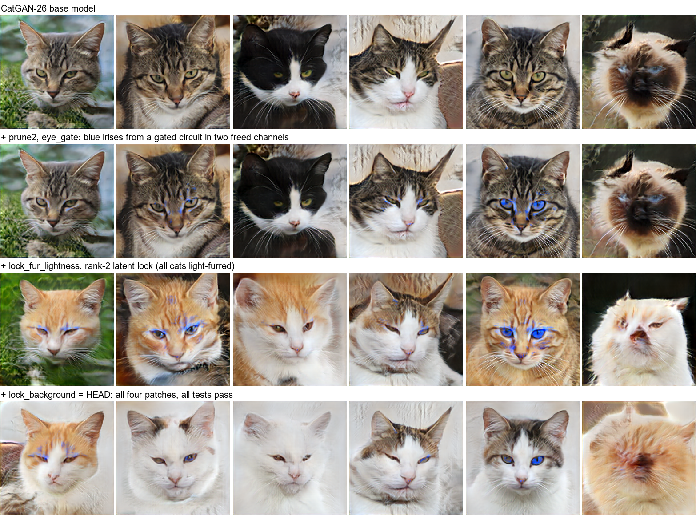
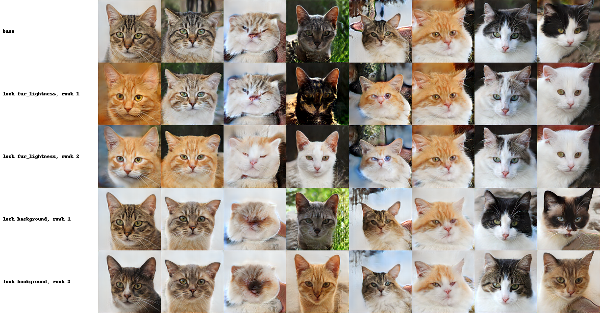
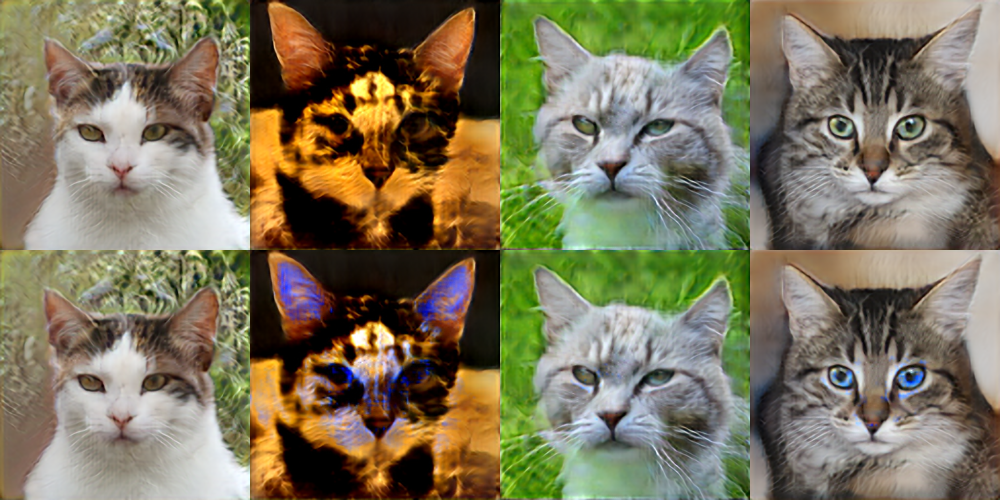
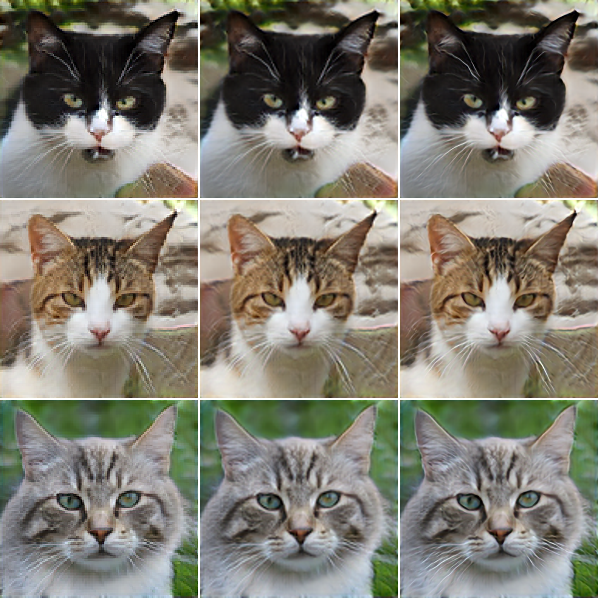
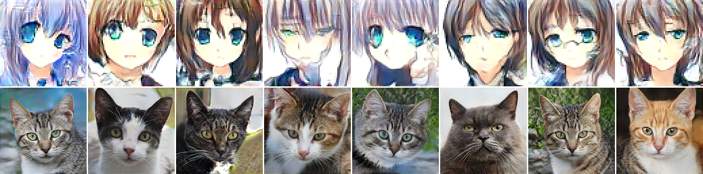

<!-- Every number traces to a file under results/ (Appendix A). Maths is LaTeX: `python paper/build_paper.py` builds wsse.html and wsse.pdf. -->

## Abstract

Language models can now read neural network weights and write edits to them directly [1]. Once edits are cheap, a model will accumulate many of them, from many authors, human and automated. That raises the questions software engineering answers for code: how changes are specified, tested against regressions, merged across branches and kept working when what they were built on changes.

We introduce Weight-Space Software Engineering (WSSE) and study it in a human-directed loop with an AI coding agent (Claude Opus 5.5).
- **Proposing edits.** The agent inspects checkpoints and writes the scripts that fit classical algebraic operators (latent clamps, channel regressions, output folds). Each edit becomes a small, hash-pinned text patch that carries its own tests (`.weightpatch.json`).
- **Accepting them.** Ordinary git plus `wpgit` gate every patch. `wpgit` builds a model from patches, tests each patch in the context of all the others, finds pairs of patches whose order matters, and rebases a repository onto an updated checkpoint.

The main case study is CatGAN-26, an 8.1M-parameter cat-face generator trained for this paper. A 15-commit git history edits it with blue irises from an exact gated circuit wired into two freed channels, rank-2 latent locks, and two latent shifts.
- **The workflow holds up.** Feature branches merge, and `git revert` reproduces a direct build bit for bit. An in-context test catches two shifts that pass alone but fail together, and `wpgit check` catches two conflicts that git merges silently.
- **The gates reject plausible proposals.**
  - a heuristic hotfix to a 2018 super-sampler that lost 3.50 dB;
  - all four exact output folds offered as its replacement;
  - one-direction latent locks that leave 68–71% of an attribute's variance against a bound of 30%;
  - an iris-threshold rule that failed on held-out cats (hue 59°, against a 200–250° target);
  - all 29 attempts to resolve a fine-tune merge conflict short of retraining.
- **Fix the patch, not the bound.** Rank-2 active-subspace locks leave 10–11% of the variance, and the repository passes every test at HEAD.
- **An updated base model.** After CatGAN-26 trains 4,000 more steps, its latent patches survive a rebase while its channel-level patches lose their guarantees. `wpgit rebase` flags those as stale after 500 steps, before any test fails. Re-running the fitting scripts regenerates the repository in 11 minutes with no manual changes. That restores each patch's guarantees but exposes a new interaction that only an in-context test catches.

The same tools also treat the first author's 2017–2020 Keras checkpoints and MobileNetV2 as legacy code: they read training history from weights alone and compile refactors exactly. Code, patches, git histories and models are released at https://github.com/v-code-895/wsse and archived at https://doi.org/10.5281/zenodo.23956114.

## 1. Introduction

A trained checkpoint is usually treated as an immutable binary: the end product of data and gradient descent. When it needs to change, the remedy is to change the data or the loss and train again. That is starting to change. Takehi et al. [1] showed that frontier language models can read weight tensors and write gradient-free edits to them. If editing weights becomes as cheap as editing code, models will collect edits the way codebases collect commits, from several authors, human and automated, over time.

Software has been here before. Hotfixes applied straight to production binaries cause silent regressions, collide with each other and break when the code beneath them changes. The answer was a discipline, not a better hotfix: changes are diffs, diffs are reviewed and tested, and version control merges them and keeps their history. **This paper asks whether that discipline transfers to weights, and what breaks when it does.**

**The idea.** We store each weight edit as a text file, a *weight patch*, that names the exact checkpoint it targets by content hash, declares the patches it depends on, describes its edit with a few compact parameters, and carries quantitative tests:

```json
{"id": "lock_fur_lightness", "base": "be2b16ff52fc4021",
 "ops":   [{"type": "latent_clamp", "layer": "dense", "direction": [-0.0326, 0.0344, ...], "target": 2.0},
           {"type": "latent_clamp", "layer": "dense", "direction": [-0.0062, 0.0191, ...], "target": 0.0}],
 "tests": [{"type": "attr_var_ratio", "attr": "fur_lightness", "vs": "base", "max": 0.3}]}
```

Because patches are text, git handles branching, merging, reverting and history unchanged. A small tool, `wpgit`, adds what git cannot know about weights (§3):
- **`build`** applies the patches in dependency order;
- **`test`** runs each patch's tests in the context of all the others;
- **`check`** finds pairs of patches whose order changes the model;
- **`rebase`** moves a repository onto an updated checkpoint and marks patches whose assumptions no longer hold.

**How patches are written: tools, not token-space guessing.** Should an edit be produced by a language model predicting raw floating-point values, by a trained hypernetwork, or by code? Here every patch is computed by classical linear algebra:
- ridge regression and active subspaces;
- Gram–Schmidt orthogonalisation;
- 1×1 channel regression;
- exact BatchNorm folding.

An AI coding agent (Claude Opus 5.5) wrote and ran those scripts under the first author's direction; we do not ask a model to compute a regression in its context window. We think compiled algebraic operators are the right unit for weight-space engineering, much as a coding agent writes source code rather than editing a compiled binary. They have two advantages:
- **Readability.** An operator reduces thousands of weight deltas to a few readable parameters, such as a 3×3 colour matrix and offset, or a pair of latent directions and their targets.
- **Separation.** It separates *proposing* a change, where an agent writes a fitting script, from *accepting* it, where `wpgit` checks base hashes, commutation and in-context behavioural bounds.

§8.2 follows each proposal in this study to what the checks made of it.



*Figure 1. CatGAN-26, our 8.1M-parameter cat generator, under version control. The same six random latents (not selected) go through successive builds of the repository of §4: the base model; the blue-eye circuit (`prune2`, `eye_gate`); a rank-2 lock that fixes fur lightness; and HEAD, which adds a background lock and passes every test. The circuit turns irises blue where it fires (column 5) but works on only part of the cats, and on dark tabby stripes it leaks blue (columns 2 and 4): §4.2 quantifies both. Images are upscaled 4× by TinySR-26 (§6).*

**What we found.** We built the tooling and used it on real models, chiefly a cat-face generator trained for this paper (Figure 1). Each finding is a lesson that software engineering already knows, made concrete for weights:

1. **Patches compose under git, and tests must run in context** (§4.3). Three feature branches merge cleanly, and a revert reproduces a direct build bit for bit. One patch passes its tests alone and fails them once merged, and only an in-context test sees it.
2. **Git merges what the weights cannot** (§4.3). Two lock branches merge without a textual conflict, yet the order in which they apply changes the model. A second pair contradicts each other's intent. `wpgit check` flags both, and each needs a different kind of resolution.
3. **Fix the patch, not the test** (§4.2–4.3). One-direction latent locks fail their tests on CatGAN-26. A rank-2 *subspace lock* passes them, and the repository goes green with the original bounds.
4. **Patches go stale when the model underneath changes** (§5). Patches written against the model's input survive 4,000 more training steps. Patches written against specific hidden channels do not, and a rebase flags them before any test fails.
5. **Fine-tunes merge trivially and compose badly** (§6). Delta patches commute exactly and still break a regression test, and no weight-space resolution we tried meets the merge's specification.
6. **Old checkpoints behave like legacy code** (§7). On the first author's 2017–2020 Keras models, weights alone reveal training history, refactors compile exactly, and a regression gate rejects a plausible hotfix that the original, untested script would have shipped.

**Contributions.**
- The `.weightpatch.json` format and `wpgit`, including in-context tests, the semantic merge check and a rebase that detects stale patches.
- Two patch techniques: **subspace locks**, which clamp an active subspace of the latent to freeze attributes the latent encodes nonlinearly, and **gated circuit wiring**, which frees channels by regression and installs an exact ReLU gate in them.
- A record of a human-directed agent loop under these gates: what was proposed, what the checks caught and how each was resolved (§8.2).
- Case studies on two models trained for this paper (CatGAN-26, TinySR-26), and on six of the first author's 2017–2020 checkpoints and MobileNetV2.
- A release of all code, patches, git histories, test results and model weights.

## 2. Related work

**Weight editing and model merging.** Existing ways to modify trained weights without full retraining fall into four families:
- *Learned editors.* MEND [30] trains auxiliary networks that turn a low-rank decomposition of the fine-tuning gradient into a fast weight update. Text-to-LoRA [34] generates low-rank adapters for a language model directly from a task description.
- *Locate-then-edit and lifelong editing.*
  - ROME [2] and MEMIT [31] make closed-form updates to factual associations in one or several layers of a language model.
  - GRACE [32] (a discrete key-value codebook) and AlphaEdit [33] (which projects each update onto the null space of preserved knowledge) address interference across sequences of edits.
  - In generative image models, GANSpace [6] and InterFaceGAN [7] steer latent directions, GAN dissection [8] identifies units with semantic roles, and Bau et al. [9] rewrite a generator's rules by editing a layer's weights.
- *Task arithmetic and merging.* Task arithmetic [3] adds and subtracts fine-tuning deltas, model soups [4] average fine-tuned weights, and TIES-merging [5] resolves sign and magnitude interference between deltas.
- *Direct weight-space programming.* Takehi et al. [1] showed that language models can read weight tensors and write gradient-free edits.

**Where WSSE differs.** Each of our operators is classical linear algebra related to the methods above. For example, the Type I conflict resolution of §3 projects onto an orthogonal complement, in the same spirit as AlphaEdit's null-space projection. What none of these methods provides is a software-engineering lifecycle around heterogeneous edits:
- one hash-pinned text format for subspace locks, gated channel circuits, output folds and fine-tune deltas alike;
- tests for every edit, run against every other edit;
- a pairwise check for order dependence;
- rebasing across upstream model updates.

In WSSE, an edit made by any of these methods would be one more patch type, and the question is what its tests catch in context.

**Version control for models.** Raffel [25] argued that models should be developed like open-source software, improved continually by many contributors through merging and versioning. Git-Theta [24] puts that into practice: a git extension that tracks parameter-level changes to checkpoints, stores updates efficiently and merges models automatically. WSSE shares the premise and differs in what a change is and how it is checked:
- **Changes:** WSSE stores an edit as a few readable parameters of a high-level operator (a direction, a target, a 3×3 colour map), not as a parameter diff.
- **Checks:** each edit carries executable tests, run in the context of every other edit; pairs of edits are checked for semantic conflicts, which no textual merge detects; and a repository can be rebased onto an updated checkpoint with stale-patch detection.

The two approaches are complementary: Git-Theta handles efficient storage and merging of weights, and WSSE handles the specification and testing of edits.

**Testing models.** Behavioural testing with CheckList [26] made capability-level unit tests standard practice for language models, and Sculley et al. [27] described how machine-learning systems accumulate technical debt that ordinary software practice must manage. WSSE's tests are behavioural tests attached to individual edits and evaluated in context, so a failing test points at the change that broke it.

**Weights as data.** A growing literature treats trained weights as a data modality to be represented, generated and edited [28], and argues that checkpoints should be first-class objects [29]. WSSE contributes engineering infrastructure for that view: identity (content hashes), history (git) and specifications (tests).

**Comparing and combining networks.** We use linear CKA [11] and model stitching [12, 13]. Unlike stitching studies that insert a trained adapter at run time, we fold the fitted 1×1 map into the receiving convolution, so the hybrid has no extra layers. Merging independently trained networks requires aligning their units first [14]. Closed-form classifier heads ("imprinting") [15] give us a cheap way to add a test oracle to a public model.

**Sensitivity analysis.** Our subspace locks use active subspaces [10]: the dominant eigenvectors of the expected outer product of a function's gradient.

## 3. Weight patches and `wpgit`

A **weight repository** is a git repository holding only text:
- `base.json` records the checkpoint's path, its content hash and, optionally, a test-domain module that defines the attributes and forward pass the tests use;
- `patches/*.weightpatch.json` holds the edits.

Built models (`build/model.npz`) are not tracked.

**Content addressing.** A checkpoint $W$ is identified by a 16-character SHA-256 prefix over its sorted tensor names and float32 bytes,
$$\text{hash}(W) = \text{SHA256}\Big(\textstyle\bigoplus_{k \in \text{sorted}(W)} \text{utf8}(k) \,\|\, \text{bytes}_{\text{f32}}(W[k])\Big)_{[:16]}.$$
`wpgit` refuses to build if the checkpoint on disk does not match `base.json`, or if a patch targets another hash. Patches may declare `requires`; they are applied in topological order, with ties broken by file name.

**Operators.** Patches store compact parameters, not expanded deltas:

| operator | acts on | definition | used for |
|---|---|---|---|
| `latent_shift` | first dense layer | $z' = z + \alpha d \Rightarrow b' = b + \alpha\, d^\top K$ | steering an attribute |
| `latent_clamp` | first dense layer | $z' = (I - dd^\top)z + t d \Rightarrow K' = K - d(d^\top K),\ b' = b + t\,d^\top K$ | freezing an attribute; $k$ orthonormal clamps lock a rank-$k$ subspace |
| `sparse_add` | any tensor | indexed deltas $\Delta W$ | channel pruning, circuit wiring |
| `fold_output_affine` | last linear conv | $K'_{hwip} = \sum_o K_{hwio} M_{po}$, $b' = Mb + t$ | colour and black-level calibration |
| `fold_output_spatial` | last linear conv | $K \leftarrow S * K$ | sharpening or blurring |
| `set_bias`, `scale_ac` | any bias / conv | $b \leftarrow v$; $K' = \bar K_{DC} + \gamma (K - \bar K_{DC})$ | ablation; high-frequency gain |
| dense delta | all tensors | $W + \Delta W$ | fine-tunes as patches (§6) |

A `fold_output_affine` patch is 12 numbers that rewrite 4,803 weights at build time. A reviewer can read it in full, which is not true of the deltas it compiles to.

**Commands.**
- **`wpgit build`** applies all patches in order and prints the resulting hash.
- **`wpgit test`** runs every patch's tests *in context*: for patch $p$ it compares the full build with the full build minus $p$ and everything that requires $p$. A patch must still do what it promises after everything else has been merged.
- **`wpgit check`** examines every pair $(A, B)$ not linked by `requires`. It builds $W_{A\circ B}$ and $W_{B\circ A}$ and reports one of three verdicts:
  - **commutes (structurally):** the two touch disjoint tensors;
  - **commutes (numerically):** $\max |W_{A\circ B} - W_{B\circ A}| < 10^{-5}$;
  - **conflict:** anything else, reported with the output difference between the two orders.
- **`wpgit rebase <weights>`** re-pins the repository to a new checkpoint with the same architecture.
  - Latent ops act on the model's *input*, so they mean the same thing on any base with that input.
  - A `sparse_add` stores a difference from the old values of its entries. Like a text diff whose context lines changed, it is marked `stale_context` when those entries have moved.
  - The tests then decide what still holds (§5).

**Two kinds of semantic conflict.** A textually clean merge can still be wrong in two ways:
- **Type I, interference.** Two patches act on overlapping subspaces, so whichever runs second partly undoes the first. This can be resolved algebraically, by orthogonalising one against the other.
- **Type II, contradiction.** Two patches want incompatible things, such as freezing the background and brightening it. No algebra helps here: a commit has to record a decision.

## 4. Case study: a cat generator under version control

### 4.1 CatGAN-26

We trained CatGAN-26 for this paper on the 5,153 cat photos of AFHQ [18] (CC BY-NC 4.0), downsampled to 128×128, on one 8 GB consumer GPU.
- **Generator (8,133,283 parameters).** It deliberately keeps a plain DCGAN-style structure [17]: dense → reshape to 4×4×512 → five blocks of [2× nearest upsample, conv, BatchNorm, LeakyReLU, conv, BatchNorm, LeakyReLU] → linear output conv. That keeps every patch operator above applicable and exact.
- **Training.** A residual discriminator with minibatch standard deviation; the non-saturating logistic loss with a lazy R1 penalty [21] ($\gamma = 0.1$, a heuristic from [20]); differentiable augmentation [19]; Adam(0, 0.99) at $2\times10^{-4}$, batch 32, bf16; an exponential moving average of the generator. 30,000 steps took about 2.9 hours. A first attempt with a spectral-normalised discriminator failed: within 2,000 steps it scored real cats, generated cats, noise and a blank image all at −0.0024 ± 0.00003.
- **Export.** BatchNorm is folded into the convolutions and the output scaling into the last layer, so the exported dict maps $z$ straight to an image in $[0,1]$. It matches the trained network to $3.8\times10^{-6}$.

**Quality**, judged by an ImageNet classifier (MobileNetV2 [16]) on 500 images per row:

| images | called a domestic cat | Fréchet distance to held-out real cats (MobileNetV2 features) | nearest training image (thumbnail correlation: median / share > 0.95) |
|---|---|---|---|
| real AFHQ validation cats | 97% | — | 0.70 / 2% |
| real AFHQ training cats | 96% | 47.1 (real-vs-real floor) | — |
| **CatGAN-26** | **96%** | 60.6 | 0.70 / 0% |
| CatGAN-26, truncation 0.7 | 97% | 68.2 | 0.72 / 0% |

CatGAN-26 samples are recognised as cats as often as real photos. As a distribution they are further from real cats than real cats are from each other, and they are no closer to their nearest training image than real held-out cats are, so there is no sign of memorisation.

### 4.2 Four kinds of patch

A test domain (`cat_domain.py`) defines what the tests measure, from regions of the mean AFHQ face:
- five pixel attributes (fur warmth, fur lightness, background, eye green, saturation);
- an iris mask;
- an eye-colour score.

Latent directions are fitted by ridge regression of each attribute on 1,200 samples. Everything is reported on 400 held-out samples.

**Steering: latent shifts.** Shifting $z$ along a fitted direction moves its attribute.
- Raw directions are entangled: on average a shift moves the *other* attributes by 2.14 SD in total.
- Orthogonalising each direction against the others cuts that to 0.36 SD, but it also erases fur warmth (−0.01 SD on target). On cats, fur warmth and saturation are nearly the same direction (cos 0.951), because orange fur *is* saturated colour.
- Orthogonalising against everything except near-duplicates (|cos| > 0.9) restores warmth: +1.25 SD on target, with 0.95 SD off target, most of it the warmth–saturation pair itself.

**Locking: from one direction to a subspace.** A `latent_clamp` pins $z$'s coordinate along a direction, so the attribute should stop varying. On CatGAN-26 it does not: the attributes are only partly linear in $z$ (held-out $R^2$ 0.32–0.66), and a one-direction lock leaves 72% of fur-lightness variance and 43% of background variance.

A **rank-$k$ subspace lock** clamps $k$ orthonormal directions, which is just $k$ `latent_clamp` ops:
- The first direction is the fitted one, with its target.
- Each further direction is the top eigenvector of $\mathbb{E}[g g^\top]$, where $g = \nabla_z a(z)$ is the attribute's gradient at already-clamped latents with the chosen directions projected out. This is an active subspace [10], refitted greedily after each clamp.
- Extra directions are clamped to 0, the latent mean.
- The rank is the smallest $k$ that brings the variance ratio to 0.2 on separate selection latents, leaving a margin under the test bound of 0.3.

| lock | rank 1 | rank 2 | rank 3 | rank 8 | random second direction (control) |
|---|---|---|---|---|---|
| fur lightness | 0.72 | **0.19** | 0.05 | 0.01 | 0.72 |
| background | 0.43 | **0.18** | 0.12 | 0.01 | 0.43 |

*Variance of the locked attribute relative to the base model (lower is better; the test bound is 0.3).*

- **One extra direction is enough** for both attributes, and it is targeted: a random second direction does nothing.
- **Exact:** the folded patch equals the latent edit to $4.1\times10^{-6}$.
- **The cost is measurable.** On 300 samples per row, the fur-lightness lock leaves the other attributes' variance at 0.88–1.08 of base, but lowers feature diversity from 0.94 at rank 1 to 0.78 at rank 2 (Fréchet distance to real cats 111 → 143). Most of the change from base comes from the lock's purpose: every cat is moved to light fur. The background lock costs little (diversity 0.96 → 0.93 from rank 1 to rank 2).



*Figure 2. The same eight latents under one-direction (rank 1) and rank-2 locks. The rank-1 fur-lightness lock still lets a black cat through; at rank 2 every cat is light.*

**Recolouring eyes: channel reclamation and a gated circuit.** Can a patch make the irises blue and leave everything else alone, without adding parameters? It takes two patches:

1. **`prune2` frees two channels** of the last hidden layer.
   - Each channel is scored by how well the other channels predict it, times the energy of its outgoing weights, and the two cheapest are chosen.
   - Each is regressed onto the remaining channels with a 1×1 ridge fit, the regression is folded into the next layer, and both slots are zeroed.
2. **`eye_gate` (requires `prune2`) wires a circuit into the freed slots.**
   - A linear iris detector reads 3×3 neighbourhoods of the layer below. It is fitted with the iris mask on fitting images only; no mask is used at run time.
   - Thresholded at a quantile $\theta$ of its scores on non-iris pixels, the detector drives the two slots with opposite signs. Because $\text{LeakyReLU}_\alpha(u) + \alpha\,\text{LeakyReLU}_\alpha(-u) = (1-\alpha^2)\,\text{ReLU}(u)$, the next layer reads an exact ReLU gate and adds an ice-blue tint only where it fires.
   - $\theta$ is chosen the way a CI pipeline would choose it: the strictest quantile whose result on the *fitting* images already passes the patch's own test (iris hue within 200–250°). That gives the 0.98 quantile. An earlier rule failed on held-out cats and was replaced; Appendix B gives the full sweep.

| edit (150 held-out cats) | weights changed | iris hue | rest-of-image change (MAE) |
|---|---|---|---|
| base | 0 | 43° | 0 |
| move along a latent "towards blue" direction (shift 2 / 4) | 0 (input edit) | 41° / 40° | 0.073 / 0.127 |
| ungated 1×1 colour fold (whole cat turns blue) | 99 | 223° | 0.136 |
| `prune2` alone | 1,445 | 37° | 0.0045 |
| **`prune2` + `eye_gate`** | 1,445 (same entries) | **214°** | **0.0059** |

- **The gate reaches a blue median hue with 23× less collateral change than the ungated fold**, barely more than freeing the channels costs. The latent route changes the whole face and never reaches the eyes.
- **Per image, it is a partial success.** 40% of held-out cats end up with irises in the 200–250° band (none did before), and 43% within 180–270°. Misses are mostly squinting or pale eyes. On average 0.8% of non-eye pixels change by more than 0.1, but 19% of cats have more than 1% such pixels, usually blue streaks on dark fur (Figure 1). A 3×3 linear detector on 32 channels separates irises from tabby stripes imperfectly.
- **MobileNetV2 still calls 95% of the patched samples domestic cats.** It says the same of a cat dyed entirely blue, so the classifier guards against breaking the generator, not against ugly edits. The pixel tests do that.



*Figure 3. The first four held-out cats (not selected), base (top) and with `prune2` + `eye_gate` (bottom), upscaled 4× by TinySR-26. Right: blue irises with the rest of the face unchanged. First and third: the gate does not fire. Second: it leaks blue onto a tortoiseshell's ears.*

**Exact refactors.** Some patches change nothing a test can see except what they claim:
- mirroring the generator by permuting kernels and the dense layout matches the flipped image to $6.3\times10^{-6}$;
- scaling the first dense kernel by 0.7 compiles the truncation trick $z \to 0.7z$ into the checkpoint, to $6.2\times10^{-6}$.

### 4.3 Fifteen commits

`exp5_git_demo.py` scripts the repository's history and records every command. The tests and their bounds were written for a 2018 anime generator (§7.5) and are reused unchanged, except the eye-hue band.

```
* 886bf1e Resolve: lock-background supersedes bright-background
* 3cde449 Resolve semantic conflict: orthogonalise background subspace lock
*   d612032 Merge feature/lock-background
|\
| * 31c6ee9 Lock background: clamp rank-2 latent subspace
* |   5fdeb04 Merge feature/lock-fur-lightness
|\ \
| |/
|/|
| * 1db987a Lock fur lightness: clamp rank-2 latent subspace
|/
* c1a5c6d Revert warm fur
*   ed1d6a1 Merge feature/blue-eyes
|\
| * 0225663 Blue eyes: gated eye-colour circuit in the freed slots
| * d978fcb Prune 2 redundant b5c2 channels (fold into out)
* |   f9d978e Merge feature/bright-background
|\ \
| * | 164dbae Bright background: shift latent along orthogonalised background direction
| |/
* |   3b8a0c5 Merge feature/warm-fur
|\ \
| |/
|/|
| * b4dc461 Warm fur: shift latent along orthogonalised fur_warmth direction
|/
* 17a7b76 Base: CatGAN-26 (AFHQ cats, 128x128)
```
*`git log --graph --oneline` of the repository. The four patches at HEAD are 88 KB of text (56 KB of it `prune2`'s sparse fold), on a 32.5 MB model.*

1. **Three feature branches merge cleanly**: warm fur, bright background, and blue eyes. `wpgit check` finds no conflicts. Four pairs touch disjoint tensors, and the two shifts share a bias vector but commute to $1.2\times10^{-7}$.
2. **One patch fails only in context.** In the merged build, the warm-fur shift moves fur warmth by +0.92 SD where its test asks for at least 1.0, and it pushes the background by −0.55 SD against a guard of ±0.3. Alone (§4.2), the same patch gave +1.25 and −0.13 SD and would have passed. Combined with the background shift, the generator's nonlinearity couples the two. A test run on the patch by itself cannot see this.
3. **The warm-fur merge is reverted.** `git revert` produces hash `b563872899972665`, identical to building {bright background, prune2, eye gate} directly. In that context the eye gate's median hue is 197.0°, just outside its band: because the circuit works on part of the cats, its median moves with context (229.8° after the merge, 197.0° after the revert, 224.6° at HEAD).
4. **Two lock branches merge without a textual conflict, and `wpgit check` reports three semantic conflicts.**
   - **Type I.** The two locks' subspaces overlap (principal-angle cosines 0.547 and 0.148), so their order changes the model ($\max|\Delta W|$ 0.75, output MAE 0.129). The resolution Gram–Schmidt-orthogonalises the background subspace against the fur-lightness subspace. It recomputes the background targets from the in-span point that satisfies all four original constraints, moving them from (2.0, 0.0) to (2.345, 1.271). The locks then commute to $2.4\times10^{-7}$.
   - **Type II.** The background lock freezes the background that the bright-background shift moves. Whichever runs last wins. No algebra makes both true, so a commit records a decision: the lock supersedes the shift. The third conflict, the fur-lightness lock against the same shift, disappears with it.
5. **HEAD passes every test** (hash `0606c0c758456bef`):

| test at HEAD (bound) | with one-direction locks (2018 style) | with rank-2 subspace locks |
|---|---|---|
| fur-lightness lock: variance ratio (≤ 0.3) | 0.708 FAIL | **0.101** PASS |
| background lock: variance ratio (≤ 0.3) | 0.677 FAIL | **0.114** PASS |
| eye hue (200–250°) | 221.9° PASS | 224.6° PASS |
| `prune2` / `eye_gate` rest-of-image change (≤ 0.015) | 0.007 / 0.003 PASS | 0.003 / 0.000 PASS |
| **all tests** | FAIL | **PASS** |

The same script with one-direction locks gives the left column. That history fails, and the tests are what say so. With one-direction locks, the generalised resolution reproduces the original one-direction run line for line.

## 5. When the base model changes: rebasing

Downstream users patch a model, and then its maintainers release a new version. In software this is a dependency upgrade: local patches are rebased onto the new upstream and the tests decide what still works.

We trained CatGAN-26 further, resuming from step 30,000 with the generator, discriminator, moving average and both optimiser states. We exported it at +500, +1,000, +2,000 and +4,000 steps exactly as the original was exported. Then `wpgit rebase` moved the repository of §4.3 onto each version, and the same tests ran.

| upstream | weights changed | output change (MAE, same latents) | `rebase`: stale patches | `prune2` / `eye_gate` rest change (≤ 0.015) | eye hue | fur / background lock (≤ 0.3) | all tests |
|---|---|---|---|---|---|---|---|
| original | — | — | — | 0.003 / 0.000 | 224.6° | 0.101 / 0.114 | pass |
| +500 steps | 3.7% | 0.045 | `prune2`, `eye_gate` | 0.006 / 0.005 | 227.0° | 0.104 / 0.109 | **pass** |
| +1,000 | 6.5% | 0.067 | both | 0.009 / 0.009 | 229.1° | 0.112 / 0.127 | **pass** |
| +2,000 | 11.1% | 0.094 | both | **0.024 / 0.024** | 227.8° | 0.154 / 0.134 | fail |
| +4,000 | 17.9% | 0.127 | both | **0.025 / 0.025** | 225.4° | 0.161 / 0.294 | fail |

- **Patches written against an interface survive; patches written against an implementation do not.**
  - The locks act on the latent, the model's input, which the update leaves alone. They hold through 4,000 steps, although the background lock is at 0.294 by then, just inside its bound.
  - `prune2` and `eye_gate` act on two specific hidden channels. `prune2` stores the difference that zeroed those channels *on the old weights*, so on new weights it leaves residue in the "freed" slots, which the gate then writes into. From 2,000 steps on, the collateral change breaks its bound. The eye colour itself still works throughout (225–229°): what breaks is the promise not to touch the rest of the image.
- **The stale-context check fires first.** `wpgit rebase` marks both channel patches stale at every step: their target entries moved by 2.8% after 500 steps and 20% after 4,000. That happens before any test fails. The check warns that a patch no longer means what it did; the tests decide whether it still meets its specification.
- **Regenerating instead of porting.** Patches are build products of fitting scripts, so the alternative to porting them is to rebuild them from source on the new base. On the +4,000 checkpoint, re-running the fitting scripts and the git story took 11 minutes with no manual changes.
  - The specification-driven choices adapted on their own: the background lock now needs rank 4, and the gate threshold drops to the 0.97 quantile.
  - The regenerated `prune2` and `eye_gate` pass in isolation and after the revert (hue 201.9°, rest change 0.006 and 0.001). The locks pass at HEAD (0.127, 0.084).
  - At HEAD, though, the regenerated gate stops firing (hue 26°). Its threshold sits one step from a cliff in its sweep (held-out hue 210° at the 0.97 quantile, 67° at 0.98), and locking every cat to light fur shifts the detector's scores past it.

Neither porting nor regenerating yields a passing repository after 4,000 steps without further work. They fail differently: porting loses the channel patches' guarantees, while regenerating restores them but exposes an interaction between new patches. Both failures are visible only to in-context tests.

## 6. When the patch is a fine-tune: merging deltas

Most changes to real models are fine-tunes. We stored two fine-tunes as dense delta patches and merged them, using a second model trained for this paper.

**TinySR-26** is a 276,732-parameter 2× super-sampler; a 292,320-parameter 4× version is used for figures. It has six residual blocks of 48 channels without normalisation [23], a sub-pixel convolution upsampler [22] and a global bicubic skip. It was trained for 30,000 steps on AFHQ crops degraded by a mix of bicubic, bilinear, box and nearest downsampling. On held-out AFHQ photos it beats bicubic interpolation by +3.0 dB when the low-resolution input was made by nearest-neighbour sampling, and by +0.4 dB at 2× (+1.0 dB at 4×) when it was made by bicubic downsampling.



*Figure 4. A 128-px CatGAN-26 sample (left, pixel-replicated), upscaled to 512 px by bicubic interpolation (middle) and by TinySR-26 4× (right).*

**Two branches.** From the same base (hash `8cb6601c1b449ffc`) we fine-tuned two branches for 3,000 steps each:
- **bicubic**, trained on bicubic-downsampled inputs only, whose claim is to be better on bicubic inputs;
- **noisy**, trained on mixed kernels plus Gaussian noise (σ up to 8/255), whose claim is to be better on noisy inputs.

Each is stored as a weight delta. Merging is addition, so it commutes exactly (the order difference is $1.5\times10^{-8}$, float rounding). The deltas are nearly orthogonal (cosine 0.088) and similar in size (16–17% of the weight norm).

PSNR change against the base on 180 held-out AFHQ photos (2×, 256 → 512 px):

| model | bicubic inputs (bicubic's claim) | noisy inputs (noisy's claim) | nearest inputs (regression guard) |
|---|---|---|---|
| base (dB) | 32.53 | 26.89 | 31.12 |
| branch: bicubic | **+0.23** | −0.47 | **−4.88** |
| branch: noisy | −0.20 | **+3.26** | −1.01 |
| merge: base + Δbicubic + Δnoisy | −0.03 | +2.56 | −4.06 |
| merge: average of the two | +0.11 | +1.89 | −3.05 |

Each branch meets its own claim and fails the regression guard. The merge keeps only part of the gains, and nothing in git or in the weights warns: the merge is clean, order-independent and between nearly orthogonal deltas. **Orthogonal in weight space is not independent in function.**

**Resolving the conflict.** We wrote the merge's specification as a test: both claims hold (gain > 0 on bicubic and on noisy inputs) and no test falls more than 0.1 dB below the base. We then tried the resolutions a weight-space toolkit offers, choosing on 120 separate fitting images.

1. **Weighted merges** (task arithmetic [3]), $W_0 + a\,\Delta_{\text{bicubic}} + b\,\Delta_{\text{noisy}}$, for $a, b \in \{0, 0.25, 0.5, 0.75, 1\}$. **None of the 25 meets the specification.** Any weighting that keeps the noisy gain costs at least 0.95 dB on nearest inputs, and adding a quarter of $\Delta_{\text{bicubic}}$ already costs 1.8–2.5 dB.
2. **Blame, then cherry-pick hunks.** Applying one layer group of a delta at a time shows where the regression comes from:

   | nearest-input change (dB) | head | block 0 | 1 | 2 | 3 | 4 | 5 | tail | up |
   |---|---|---|---|---|---|---|---|---|---|
   | $\Delta_{\text{bicubic}}$ alone | −0.09 | −1.28 | −0.69 | −0.48 | −2.35 | **−3.11** | −0.65 | −0.14 | −0.54 |
   | $\Delta_{\text{noisy}}$ alone | −0.41 | −1.87 | **−2.02** | −1.12 | −0.15 | +0.06 | −0.03 | −0.14 | −0.30 |

   The regression is spread over the network. Dropping the worst groups until it is within 0.1 dB removes eight of nine groups of $\Delta_{\text{bicubic}}$, and with them its gain. For $\Delta_{\text{noisy}}$, the two groups left over are worse than nothing (−4.16 dB on its own claim). **A fine-tune delta only works whole**: the partial revert that is routine for code breaks it.
3. **A resolution commit:** 1,000 more steps of fine-tuning from the merged model on all three input types, stored as one more delta. It repairs most of the regression (−0.22 dB on nearest inputs) but loses the bicubic gain (−0.19 dB).

The only candidate that meets the specification is to retrain once on the union of both branches' objectives, 3,000 steps from the base: +0.03, +3.19 and +0.08 dB. That is the equivalent of squashing the branches and redoing the work against the combined specification. Even then only +0.03 dB of the bicubic branch's +0.23 dB survives: at this size, specialising for bicubic inputs and staying robust to nearest inputs compete. **For fine-tunes, merging is cheap and the tests are what matter.**

## 7. Legacy checkpoints as legacy code

The toolkit started life on checkpoints the first author trained in 2017–2020 as an undergraduate, in Keras 2. They have no tests, no documentation of their training runs and, in places, bugs. They are legacy code, and the questions are the ones legacy code raises: what does it do, can we change it safely, and can we read its history from what is left?

| model | task | parameters |
|---|---|---|
| TinySR-18A, TinySR-18B | 2× super-sampling GANs ("DLSS" in the original repository, unrelated to NVIDIA's) | 317,059; 597,379 |
| Anime-DCGAN | 64×64 anime faces | 252,931 |
| Cat-GAN, PCA-GAN | 64×64 cat faces from 512 PCA coefficients | 587,715 each |
| Recycle-Bot | trash vs recycling classifier | 741,121 |
| MobileNetV2 [16] (public) | ImageNet classifier | 3,538,984 |

### 7.1 Reading weights without running them

**A static audit** (`extract_and_audit.py`) reads tensors and configuration only.
- For TinySR-18A it finds a positive output bias (0.090, 0.046, 0.034) that lifts pure black. Neither audited model has dead or duplicate channels.
- Effective rank is not unused capacity: PCA-GAN's 512×512 dense layer scores 216.5, against about 369 for a random matrix of that size. That is a concentrated spectrum, not a rank-deficient one.

**Blind predictions** were recorded from weights and configuration alone before any model was run (Recycle-Bot):
- **Confirmed:** the two dense layers have only Dropout between them, so the 590K-parameter head collapses to one 2,304-weight vector.
- **Confirmed:** every BatchNorm scale is positive and the trunk uses only valid padding and max-pooling, so all five BatchNorms fold exactly.
- **Refuted:** a spatial-attention map read from the collapsed head did not predict occlusion sensitivity (correlation −0.21).

**Training history in the weights.**
- **Recycle-Bot's step count.** Keras initialises BatchNorm running variance at 1 and decays it by 0.99 per step, so a barely-moved statistic sits near $0.99^n$. The first layer's median running variance of 0.8347 gives $n \approx 18$, and the training notebook confirms 18 steps: 63 images, batch 25, early stopping at epoch 6.
- **MobileNetV2's training data.** Conv1 has no bias, so `bn_Conv1`'s running mean is its 32 filter sums times the training set's mean colour. Solving that system ($R^2 = 1.000$) gives (122.3, 116.2, 102.9), within 1.4 levels of the published ImageNet mean.
- **MobileNetV2's label hierarchy.** For the 118 dog breeds, 98% of each breed's five nearest classifier vectors are also dogs (12% by chance).

**Two repositories with no common ancestor.** Cat-GAN and PCA-GAN share an architecture, an input and a dataset, and could plausibly be two checkpoints of one run. The weights say otherwise: every tensor pair correlates near zero (−0.004 to +0.025), and same-index filters have mean |cos| 0.019, the level of random vectors. In version-control terms they share no root commit, so no patch or merge transfers between them until their units are aligned [14].

### 7.2 A hotfix, and the regression gate that stops it

The audit's finding, a positive bias lifting pure black, invited a hotfix. The first script (`exp2_tinysr18_patch_v1.py`) made two hand-written edits with no tests: it zeroed the output bias and boosted the high-frequency part of the last two kernels by 1.18× and 1.25×. It cut the black lift from +8.40 to +3.29 RGB, and lost 2.67 dB on smooth gradients.

The harness written in response (`exp2b`) tests itself first, on a stand-in network with a planted colour defect: it recovers the inverse to within 0.021 per entry. It then fits candidate folds on a calibration split and gates them on held-out images. A patch must lose at most 0.10 dB and 0.005 SSIM on five regression images, gain PSNR on seven edge cases, and lower their black floor below the base's 8.90 RGB.

| variant (TinySR-18A) | regression ΔPSNR | edge ΔPSNR | black floor (RGB) | weights changed | gate |
|---|---|---|---|---|---|
| v1 hotfix (bias zero + boost) | −3.50 | −1.48 | 4.63 | 107,203 | FAIL (regression) |
| v1, bias only | −3.51 | −1.62 | 4.40 | 3 | FAIL (regression) |
| `color_fold` (12 numbers) | **+2.93** | +1.81 | 13.51 | 4,803 | FAIL (black floor rises) |
| `color_fold_black` (dark pixels ×256) | −8.98 | −6.10 | **3.85** | 4,803 | FAIL (regression) |
| `sharpen_fold` | +0.04 | −0.00 | 9.00 | 4,800 | FAIL (no edge gain) |

- **The gate blocks the hotfix.** Zeroing the bias alone accounts for the whole loss: the bias was compensating for features that are too dark, and the hotfix removed the compensation.
- **The gate also diagnoses the defect.** No affine output fold fixes both problems. The best one recovers +2.93 dB but raises the black floor, and anchoring black destroys mid-tones (Appendix B gives the trade-off curve). TinySR-18A's tone error is nonlinear, and no output-layer patch can express it.
- **A rewrite has nothing left to fix.** TinySR-26 (§6) has 13% fewer parameters and beats TinySR-18A by 6–15 dB on every test set. The best affine colour correction for it is the identity (+0.0007 dB, against +2.26 dB for TinySR-18A). On healthy models, useful patches add behaviour rather than repair it.

### 7.3 Exact refactors and deployment fixes

| model | refactor | parameters | max output difference |
|---|---|---|---|
| Recycle-Bot | fold 5 BatchNorms; collapse the linear–Dropout–linear head | 741,121 → 151,809 (−80%) | 2.9 × 10⁻⁶ |
| MobileNetV2 | fold all 52 BatchNorms | 3,538,984 → 3,487,816 | 5.5 × 10⁻⁵ (logits) |
| MobileNetV2 | fold uint8 preprocessing (x/127.5 − 1) into Conv1, with padding value 127.5 | unchanged | 2.5 × 10⁻⁵ |
| MobileNetV2 | fold an RGB → BGR swap into Conv1 | unchanged | 2.3 × 10⁻⁵ |
| Anime-DCGAN | exact mirror / 90° rotation by kernel and layout permutation | unchanged | 1.3 × 10⁻⁶ / 1.5 × 10⁻⁶ |

**The padding constant.** Folding the preprocessing into Conv1 is exact in the interior and wrong at the border (logit error 1.6), because zero padding in $[-1,1]$ space is 127.5 in raw pixel space. Once the padding value is part of the patch, the fold is exact. On raw uint8 input, agreement with the correctly preprocessed model rises from 0% to 100%; for BGR input it rises from 70% to 100%.

### 7.4 Stitching related checkpoints

TinySR-18A and TinySR-18B share an interface (128 → 256 px RGB) and nothing else: 5×5 kernels and 64 channels against 3×3 and 128.
- **Similar representations.** Hidden layers at matching resolutions align strongly (linear CKA 0.68–0.86, against 0.00 for a shuffled control).
- **Non-transferable patches.** Each model's colour fix still fails on the other. A's own fold lifts it from 22.75 to 25.02 dB, and B's fold drops it to 21.90 dB. A calibration patch encodes one run's drift, which is why patches pin a hash.
- **Exact stitches.** Folding a fitted 1×1 map between the front of one model and the back of the other gives hybrids with no adapter layers. One, the front of A feeding the back of B, scores 23.71 dB on natural images and 20.11 dB on sprites with fewer parameters than either parent (parents 22.75/19.45 and 22.31/19.57 dB). On the legacy test image it loses to B (20.97 vs 23.88).

### 7.5 Where the toolkit came from

The latent operators, the circuit wiring and the git workflow were first built for Anime-DCGAN, a 252,931-parameter generator from 2018. CatGAN-26 is 32× larger and was trained with 2026 practice. Its patch operators and `wpgit` ran on it unchanged, apart from two backward-compatible parameters (layer names, target colour) and a test-domain hook. The 2018 repository's results were re-checked to be bit-identical after those changes.

| | Anime-DCGAN (2018) | CatGAN-26 (2026) |
|---|---|---|
| parameters | 252,931 | 8,133,283 |
| latent attributes: held-out $R^2$ of one direction | 0.66–0.90 (one attribute 0.09) | 0.32–0.66 |
| one-direction lock: variance ratio | 0.06–0.26 (five of six attributes) | 0.41–0.83 (three of five); about 2 for the other two |
| eye circuit: hue, and collateral change vs ungated fold | 183° → 296°, 7× lower | 43° → 214°, 23× lower |
| per-image eye success | — | 40% |
| git story: conflicts found / all tests at HEAD | 2 / pass | 3 / pass (with subspace locks) |



*Figure 5. Anime-DCGAN samples (64 px, 2018, top) and CatGAN-26 samples (128 px, 2026, bottom).*

The tools transferred; the patches' quality did not transfer automatically. On the 2026 model the latent is less linear, so one-direction locks fail; the iris circuit works on part of the cats; and two shifts that pass alone interact once merged. In each case the in-context tests, not the merge machinery, reported it.

### 7.6 A patch that adds a test oracle, and one that does not compress

- **An oracle by patch.** A shrunk Fisher discriminant, fitted on 24 generated anime faces against 146 negative crops, is appended to MobileNetV2 as class 1000, "anime face", in the spirit of imprinting [15].
  - It recognises 100% of held-out generated faces and a real anime frame, with 0% false positives on held-out negatives, whose original labels are unchanged.
  - Used as an oracle for Anime-DCGAN's patches, it accepts every edit (mirror, rotation, styles, warm hair, magenta eyes) and rejects random weights (6%).
- **Low-rank truncation of MobileNetV2's classifier fails.** 814 of 1,000 singular directions are needed for 99% of the energy. Rank 256 keeps the original top-1 class on 80% of inputs, and rank 512 on 92%. A concentrated spectrum is not a compressible one.

## 8. Discussion

### 8.1 What only the tests caught

Across the studies, git never reported a problem, and the merges were always clean. Every problem below was found by an in-context test, by the merge check or by the rebase's context check:

| what happened | where | caught by |
|---|---|---|
| a shift that passes alone fails once merged with another shift | §4.3 | in-context test |
| two locks whose order changes the model | §4.3 | `wpgit check` (Type I) |
| a lock and a shift that contradict each other | §4.3 | `wpgit check` (Type II) |
| one-direction locks that do not lock | §4.2–4.3 | in-context test, then a better patch |
| an eye circuit whose median hue moves with context (229.8° → 197.0° → 224.6°) | §4.3 | in-context test |
| channel patches that no longer mean what they did on an updated model | §5 | `wpgit rebase` context check, at +500 steps |
| the same patches breaking their collateral bound | §5 | in-context test, at +2,000 steps |
| a regenerated gate that stops firing under regenerated locks | §5 | in-context test |
| a fine-tune merge that breaks a regression guard, with no weight-space fix | §6 | regression test |
| a hotfix that costs 3.5 dB | §7.2 | regression gate |

### 8.2 The human–agent loop, proposal by proposal

Each operator in §3 is linear algebra that a skilled engineer could write by hand. The practical bottleneck in maintaining a model through patches is the loop around them:
1. propose an edit;
2. find out what it breaks in context;
3. decide whether to reformulate the patch, resolve a conflict or reject the change.

In this study the first author set the goals and approved the test specifications. An AI coding agent (Claude Opus 5.5) wrote the fitting code, proposed candidate patches and ran `wpgit`; the first, untested scripts in §7.2 predate this workflow. §8.1 lists what the checks caught. The table below follows each proposal to its resolution:

| proposal | what caught it | outcome | resolution |
|---|---|---|---|
| hotfix to TinySR-18A: zero the output bias, boost high frequencies 1.18× and 1.25× (§7.2) | regression gate | black lift +8.40 → +3.29 RGB, but −3.50 dB on held-out photos | an ablation showed zeroing the bias alone costs −3.51 dB; rejected |
| four exact output folds as replacements (§7.2) | regression gate | 0 of 4 pass; the best gains +2.93 dB but raises the black floor 8.90 → 13.51 RGB | a six-point dark-weight sweep shows the tone error is nonlinear; no fold shipped |
| CatGAN-26 trained with a spectral-normalised discriminator (§4.1) | training diagnostics | the discriminator scored real cats, generated cats, noise and a blank image all at −0.0024 ± 0.00003 within 2,000 steps | no spectral norm: a lazy R1 penalty and He initialisation; trained 30,000 steps |
| latent shifts orthogonalised against all other attributes (§4.2) | on-target measurement | fur warmth erased (−0.01 SD), because warmth and saturation nearly coincide (cos 0.951) | keep near-duplicates (\|cos\| > 0.9); warmth restored to +1.25 SD |
| iris-gate threshold set so expected false positives equal iris area (§4.2) | the patch's own test, on held-out cats | irises not blue (hue 59°; target 200–250°) | choose the strictest quantile that passes on fitting images (0.98) |
| one-direction latent locks on CatGAN-26 (§4.2–4.3) | `wpgit test` at HEAD | variance ratios 0.708 and 0.677 against a bound of 0.3 | bound kept; rank-2 active-subspace locks pass at 0.101 and 0.114 |
| two fine-tune branches merged as deltas, then 29 resolutions short of retraining: 25 weightings, two layer cherry-picks and their merge, a 1,000-step repair (§6) | the merge's specification test | none passes: each loses a claimed gain or breaks the nearest-input guard | only joint retraining passes (+0.03, +3.19, +0.08 dB) |
| porting the cat repository to CatGAN-26 trained further, vs regenerating it (§5) | `wpgit rebase`, then `wpgit test` | ported channel patches stale from +500 steps and failing from +2,000; regenerated patches pass alone but the gate stops firing at HEAD (26°) | regeneration works with no manual changes; in-context tests remain necessary |

Every proposal in the table ran without error and looked reasonable when it was written. What stopped each one was a measurement, not a reviewer's intuition. That is the case for the loop: agents write algebraic operators, and reproducible weight-space tests accept or reject them.

### 8.3 Lessons for weight-space tooling

1. **Test in context, always.** Patches that pass alone fail together, and the reverse.
2. **Prefer patches written against interfaces.** Latent patches survived an upstream update that broke channel-level ones. When a patch must touch internals, it should record what it assumes, so a rebase can detect staleness. `sparse_add` lacked that, and `wpgit rebase` recovers it by comparing old and new weights.
3. **Keep the specification and change the patch.** The locks went green through a better patch (rank 2), not a looser bound. A threshold that sits next to a cliff (§5) is a fragile patch even when it passes.
4. **Prefer reviewable operators.** A 12-number colour fold or a 2-direction lock can be read in full. A dense fine-tune delta can only be reviewed by its tests, and it cannot be partially reverted.
5. **Treat fitted patches as build products.** Keeping the fitting script with the patch makes regeneration possible. Regeneration then needs its own tests, because new patches create new interactions.

### 8.4 The boundary of gradient-free patching

**Inside**, with exact or near-exact results:
- exact refactors: BatchNorm folding, head collapse, deployment fixes, symmetry, truncation;
- affine recalibration when the defect is affine;
- steering, and locking attributes the latent encodes linearly or in a low-rank nonlinear way;
- channel reclamation with gated circuits;
- stitching related models, and closed-form classifier heads.

**Outside:**
- nonlinear tone errors (§7.2);
- attributes with almost no latent support (Anime-DCGAN's saturation, held-out $R^2$ 0.09; whether a subspace lock reaches it is untested);
- transfer between checkpoints with no common ancestor (§7.1, §7.4);
- resolving a behavioural conflict between fine-tunes (§6).

### 8.5 Limitations

- **Scale.** The models span 253K–8.1M parameters. The primitives are dimension-agnostic linear algebra, but running `wpgit check` and in-context suites on billion-parameter language models is future work.
- **Small and partly synthetic tests.** Generator attributes are pixel heuristics, checked by an ImageNet classifier. CatGAN-26's quality is judged in MobileNetV2 features rather than with Inception-based FID or people. The TinySR-18 gate uses 5 regression and 7 edge-case images.
- **Single runs.** Each 2026 model was trained once, with one seed.
- **Patch choices made after failures.** The cat repository's tests reuse the 2018 bounds, but two patch-side choices followed failures: the gate-threshold rule and the subspace locks. Both select on fitting data only, and the earlier versions are reported.
- **Environment.** The synthetic sprite tests are drawn with Pillow, whose rasteriser changed between versions. All reported numbers come from the pinned release environment (Appendix A).

### 8.6 Outlook

The motivating scenario is automated maintenance: language-model agents proposing weight patches [1]. The workflow here is built for that. The agent proposes, and `wpgit` gates every proposal with tests written by people. Natural next steps:
- `git bisect run python src/wpgit.py test .` to find a breaking patch in $O(\log N)$ builds;
- semantic versioning for checkpoints, by whether a patch changes hidden representations;
- patch formats that carry their own context, as source diffs do;
- in-context suites for language models.

## 9. Conclusion

Weight edits can be managed like code. Stored as hash-pinned, self-testing text patches, they branch, merge, revert and rebase under ordinary git, and a small tool supplies what git cannot know: in-context tests, a semantic merge check and stale-patch detection. On a cat generator trained for this paper, a 15-commit history exercises all of it and ends with every test passing, after a better patch replaced one that failed. The most useful component throughout was the plainest one, a test run in the context of every other change. It caught interactions between patches, conflicts that git merged silently, patches gone stale under an updated model, and fine-tunes that merge cleanly and compose badly.

## Author contributions and AI disclosure

- **Voravee Upatising** trained the 2017–2020 checkpoints and conceived weight-space software engineering as a research direction. Voravee Upatising defined the questions and the scope of every experiment, chose which results to pursue, and wrote the drafts this paper builds on. Voravee Upatising is responsible for the content of the paper.
- **Claude** (Anthropic; model Claude Opus 5.5), an AI system, wrote most of the code under Voravee Upatising's direction: the NumPy engine, `wpgit`, the experiment scripts and the training code for TinySR-26 and CatGAN-26. It also ran the experiments, analysed the results and drafted much of the text.
- Voravee Upatising lists Claude as a co-author to state its contribution plainly. Claude cannot take responsibility for the work in the way a human author can. Venues whose policies do not allow AI authors should read this paper as authored by Voravee Upatising, with Claude's contribution acknowledged here.

## References

[1] R. Takehi, J. Teoh, A. Zhang, O. Khattab (MIT CSAIL). Sparks of Weight-Space Programming: LLMs can natively read & write neural network weights. Blog post, November 2, 2026. https://rikiyat.github.io/blog/weight-space-programming/

[2] K. Meng, D. Bau, A. Andonian, Y. Belinkov. Locating and Editing Factual Associations in GPT. NeurIPS 2022.

[3] G. Ilharco, M. T. Ribeiro, M. Wortsman, S. Gururangan, L. Schmidt, H. Hajishirzi, A. Farhadi. Editing Models with Task Arithmetic. ICLR 2023.

[4] M. Wortsman, G. Ilharco, S. Y. Gadre, R. Roelofs, R. Gontijo-Lopes, A. S. Morcos, H. Namkoong, A. Farhadi, Y. Carmon, S. Kornblith, L. Schmidt. Model Soups: Averaging Weights of Multiple Fine-Tuned Models Improves Accuracy without Increasing Inference Time. ICML 2022.

[5] P. Yadav, D. Tam, L. Choshen, C. Raffel, M. Bansal. TIES-Merging: Resolving Interference When Merging Models. NeurIPS 2023.

[6] E. Härkönen, A. Hertzmann, J. Lehtinen, S. Paris. GANSpace: Discovering Interpretable GAN Controls. NeurIPS 2020.

[7] Y. Shen, J. Gu, X. Tang, B. Zhou. Interpreting the Latent Space of GANs for Semantic Face Editing. CVPR 2020.

[8] D. Bau, J.-Y. Zhu, H. Strobelt, B. Zhou, J. B. Tenenbaum, W. T. Freeman, A. Torralba. GAN Dissection: Visualizing and Understanding Generative Adversarial Networks. ICLR 2019.

[9] D. Bau, S. Liu, T. Wang, J.-Y. Zhu, A. Torralba. Rewriting a Deep Generative Model. ECCV 2020.

[10] P. G. Constantine, E. Dow, Q. Wang. Active Subspace Methods in Theory and Practice: Applications to Kriging Surfaces. SIAM Journal on Scientific Computing 36(4), A1500–A1524, 2014.

[11] S. Kornblith, M. Norouzi, H. Lee, G. Hinton. Similarity of Neural Network Representations Revisited. ICML 2019.

[12] K. Lenc, A. Vedaldi. Understanding Image Representations by Measuring Their Equivariance and Equivalence. CVPR 2015.

[13] Y. Bansal, P. Nakkiran, B. Barak. Revisiting Model Stitching to Compare Neural Representations. NeurIPS 2021.

[14] S. Ainsworth, J. Hayase, S. Srinivasa. Git Re-Basin: Merging Models modulo Permutation Symmetries. ICLR 2023.

[15] H. Qi, M. Brown, D. Lowe. Low-Shot Learning with Imprinted Weights. CVPR 2018.

[16] M. Sandler, A. Howard, M. Zhu, A. Zhmoginov, L.-C. Chen. MobileNetV2: Inverted Residuals and Linear Bottlenecks. CVPR 2018.

[17] A. Radford, L. Metz, S. Chintala. Unsupervised Representation Learning with Deep Convolutional Generative Adversarial Networks. ICLR 2016.

[18] Y. Choi, Y. Uh, J. Yoo, J.-W. Ha. StarGAN v2: Diverse Image Synthesis for Multiple Domains. CVPR 2020, pp. 8188–8197. (AFHQ dataset, CC BY-NC 4.0, NAVER Corporation.)

[19] S. Zhao, Z. Liu, J. Lin, J.-Y. Zhu, S. Han. Differentiable Augmentation for Data-Efficient GAN Training. NeurIPS 2020.

[20] T. Karras, M. Aittala, J. Hellsten, S. Laine, J. Lehtinen, T. Aila. Training Generative Adversarial Networks with Limited Data. NeurIPS 2020.

[21] L. Mescheder, A. Geiger, S. Nowozin. Which Training Methods for GANs do actually Converge? ICML 2018, PMLR 80:3481–3490.

[22] W. Shi, J. Caballero, F. Huszár, J. Totz, A. P. Aitken, R. Bishop, D. Rueckert, Z. Wang. Real-Time Single Image and Video Super-Resolution Using an Efficient Sub-Pixel Convolutional Neural Network. CVPR 2016.

[23] B. Lim, S. Son, H. Kim, S. Nah, K. M. Lee. Enhanced Deep Residual Networks for Single Image Super-Resolution. CVPR Workshops 2017.

[24] N. Kandpal, B. Lester, M. Muqeeth, A. Mascarenhas, M. Evans, V. Baskaran, T. Huang, H. Liu, C. Raffel. Git-Theta: A Git Extension for Collaborative Development of Machine Learning Models. ICML 2023, PMLR 202:15708–15719.

[25] C. Raffel. Building Machine Learning Models Like Open Source Software. Communications of the ACM 66(2):38–40, 2023.

[26] M. T. Ribeiro, T. Wu, C. Guestrin, S. Singh. Beyond Accuracy: Behavioral Testing of NLP Models with CheckList. ACL 2020, pp. 4902–4912.

[27] D. Sculley, G. Holt, D. Golovin, E. Davydov, T. Phillips, D. Ebner, V. Chaudhary, M. Young, J.-F. Crespo, D. Dennison. Hidden Technical Debt in Machine Learning Systems. NeurIPS 2015, pp. 2503–2511.

[28] X. Han, Z. Wang, B. Zhao, B. Zhang, J. Li, D. Borth, R. Yu, H. Maron, Y. Ye, L. Yin, F. Neri. A Survey of Weight Space Learning: Understanding, Representation, and Generation. arXiv:2603.10090, 2026.

[29] Z. Wang, K. Wang, P. Wang. Position: Weight Space Should Be a First-Class Generative AI Modality. ICML 2026.

[30] E. Mitchell, C. Lin, A. Bosselut, C. Finn, C. D. Manning. Fast Model Editing at Scale. ICLR 2022.

[31] K. Meng, A. Sen Sharma, A. Andonian, Y. Belinkov, D. Bau. Mass-Editing Memory in a Transformer. ICLR 2023.

[32] T. Hartvigsen, S. Sankaranarayanan, H. Palangi, Y. Kim, M. Ghassemi. Aging with GRACE: Lifelong Model Editing with Discrete Key-Value Adaptors. NeurIPS 2023.

[33] J. Fang, H. Jiang, K. Wang, Y. Ma, J. Shi, X. Wang, X. He, T.-S. Chua. AlphaEdit: Null-Space Constrained Knowledge Editing for Language Models. ICLR 2025.

[34] R. Charakorn, E. Cetin, Y. Tang, R. T. Lange. Text-to-LoRA: Instant Transformer Adaption. ICML 2025, PMLR 267:7485–7514.

## Appendix A: Reproducing the results

Code, results, the 2017–2020 checkpoints and the git histories are in the accompanying repository, https://github.com/v-code-895/wsse, archived on Zenodo at https://doi.org/10.5281/zenodo.23956114 (all versions). The code is MIT-licensed; model weights and figures are CC BY-NC 4.0 because TinySR-26 and CatGAN-26 are trained on AFHQ. Run every script from the repository root, e.g. `python src/exp3_anime_weightpatch.py`.

**Environment.**
- CPU experiments (§7 and the anime generator) use Python 3.9.12, NumPy 1.22.4, Pillow 9.0.1, h5py 3.6.0 and scikit-image 0.19.2. Pillow is pinned because it draws the synthetic sprite tests.
- The 2026 models train and evaluate in PyTorch 2.8.0 with CUDA 12.6 on one RTX 3050 (8 GB), with comparisons in full fp32. Their weights are exported to `.npz` dicts and checked against the NumPy engine.
- Third-party data (AFHQ, MobileNetV2 weights) is fetched by `scripts/download_data.py`. The CatGAN-26 weights are release assets, fetched by `scripts/fetch_models.py`.

| section | script(s) in `src/` | outputs in `results/` |
|---|---|---|
| Figure 1 | `make_figure1.py` | `figure1/` |
| §4.1 | `exp11_catgan26.py`, `exp12_modern_eval.py` | `exp11_out/`, `exp12_out/` |
| §4.2 | `cat_domain.py`, `exp13_catgan26_patches.py`, `exp15_subspace_locks.py` | `exp13_out/`, `exp15_out/` |
| §4.3 | `wpgit.py`, `exp5_git_demo.py --profile cat_subspace` (and `--profile cat` for one-direction locks) | `exp5_cat_subspace_out/`, `exp5_cat_out/` (transcripts, `weightrepo.bundle`) |
| §5 | `exp17_rebase.py` | `exp17_out/` |
| §6 | `exp10_tinysr26.py`, `exp14_tinysr26_branches.py`, `exp16_merge_resolution.py` | `exp10_out/`, `exp14_out/`, `exp16_out/` |
| §7.1 | `extract_and_audit.py`, `exp7_blind_audit.py`, `exp7b_recycle_bot.py`, `exp8_mobilenet.py` | `audit/`, `exp7_out/`, `exp8_out/` |
| §7.2 | `exp2_tinysr18_patch_v1.py`, `exp2b_tinysr18_weightpatch.py`, `exp12_modern_eval.py A` | `exp2_out/`, `exp2b_selftest/`, `exp2b_out/`, `exp12_out/` |
| §7.3 | `exp7b_recycle_bot.py`, `exp8_mobilenet.py`, `exp7d_anime_styles.py` | `exp7_out/`, `exp8_out/` |
| §7.4 | `exp6_tinysr18_pair_transfer.py --lr-filter nearest` | `exp6_out/` |
| §7.5 | `exp3_anime_weightpatch.py`, `exp4_anime_eye_circuit.py`, `exp5_git_demo.py` | `exp3_out/`, `exp4_out/`, `exp5_out/` |
| §7.6 | `exp8_mobilenet.py`, `exp8b_oracle.py` | `exp8_out/` |

Base hashes: CatGAN-26 `be2b16ff52fc4021`, TinySR-26 2× `8cb6601c1b449ffc`, Anime-DCGAN `145ec232ed8a91e5`, TinySR-18A `3c0f6f6dc471e183`.

**What was re-run from the repository.** Before release, every CPU experiment (`scripts/reproduce_cpu.sh`) and the three git demos were re-run from the repository layout and compared with the original outputs. They are identical apart from runtimes, git commit ids and reworded labels. The GPU experiments were run once on the original machine, and their outputs are included as produced.

## Appendix B: Additional results

**CatGAN-26 latent attributes** (400 held-out samples; one-direction lock at target 2):

| attribute | held-out $R^2$ of one direction | after orthogonalising against all others | keeping near-duplicates | one-direction lock: variance ratio |
|---|---|---|---|---|
| fur warmth | 0.315 | 0.001 | 0.221 | 1.99 |
| fur lightness | 0.438 | 0.312 | 0.312 | 0.83 |
| background | 0.661 | 0.588 | 0.588 | 0.41 |
| eye green | 0.510 | 0.386 | 0.386 | 0.49 |
| saturation | 0.462 | 0.076 | 0.325 | 2.11 |

The lock ratios here are on 400 held-out samples; §4.2 reports the 1,024 selection latents of the subspace-lock experiment (0.72 and 0.43). A ratio above 1 means the lock made the attribute more variable.

**Eye-gate threshold sweep.** The shipped quantile is the strictest whose *fitting-image* hue is in band. The cliff between 0.98 and 0.99 is where the detector's scores on irises and on the most iris-like fur overlap.

| quantile | fitting-image hue | held-out hue | rest-of-image change |
|---|---|---|---|
| 0.90 | 225° | 224° | 0.0114 |
| 0.95 | 224° | 224° | 0.0078 |
| 0.97 | 223° | 220° | 0.0065 |
| **0.98** | 219° | 214° | 0.0059 |
| 0.99 | 41° | 38° | 0.0052 |

**CatGAN-26 patches and an ImageNet classifier** (share of 64 samples whose top class is a domestic cat): base 95%; mirror 98%; truncation 95%; the five shifts 89–98%; locks 91% and 95%; ungated colour fold 95%; `prune2` + `eye_gate` 95%.

**TinySR-18A colour folds: the dark-pixel trade-off** (calibration split; base black floor 6.93 RGB):

| dark-pixel weight | ×1 | ×4 | ×16 | ×64 | ×256 | ×1024 |
|---|---|---|---|---|---|---|
| calibration PSNR (dB) | 23.39 | 23.29 | 21.64 | 17.24 | 13.21 | 11.32 |
| black floor (RGB) | 11.10 | 8.04 | 6.29 | 4.53 | 2.76 | 1.81 |

**TinySR-26 against TinySR-18A and bicubic interpolation** (PSNR dB / SSIM, means over held-out images):

| test (2× unless stated) | low-res input made by | bicubic | TinySR-18A | TinySR-26 |
|---|---|---|---|---|
| natural photos (4) | nearest | 26.77 / 0.838 | 22.75 / 0.736 | **29.89 / 0.894** |
| natural photos (4) | bicubic | **29.72 / 0.892** | 22.30 / 0.697 | 29.35 / 0.879 |
| sprites (6) | nearest | 22.93 / 0.923 | 19.45 / 0.679 | **25.48 / 0.937** |
| AFHQ validation, 300 photos | nearest | 28.78 / 0.864 | 20.68 / 0.793 | **31.82 / 0.910** |
| AFHQ validation, 300 photos | bicubic | 32.02 / 0.910 | 20.49 / 0.758 | **32.43 / 0.921** |
| AFHQ validation, 300 photos, **4×** | bicubic | 29.21 / 0.794 | 15.38 / 0.560 (2× twice) | **30.17 / 0.827** |

**Weighted fine-tune merges** (fitting split; Δ dB as bicubic / noisy / nearest; none meets the specification):

| $a$ \ $b$ | 0 | 0.25 | 0.5 | 0.75 | 1 |
|---|---|---|---|---|---|
| 0 | 0 / 0 / 0 | −0.11 / +0.76 / −1.87 | −0.15 / +1.52 / −1.27 | −0.19 / +2.78 / −0.95 | −0.20 / +3.41 / −1.09 |
| 0.5 | +0.17 / −0.42 / −3.38 | +0.15 / +0.71 / −3.31 | +0.09 / +1.70 / −3.07 | +0.03 / +2.54 / −2.79 | −0.04 / +3.10 / −2.73 |
| 1 | +0.23 / −0.88 / −4.78 | +0.19 / +0.40 / −4.61 | +0.12 / +1.24 / −4.41 | +0.04 / +1.94 / −4.19 | −0.07 / +2.48 / −4.01 |
