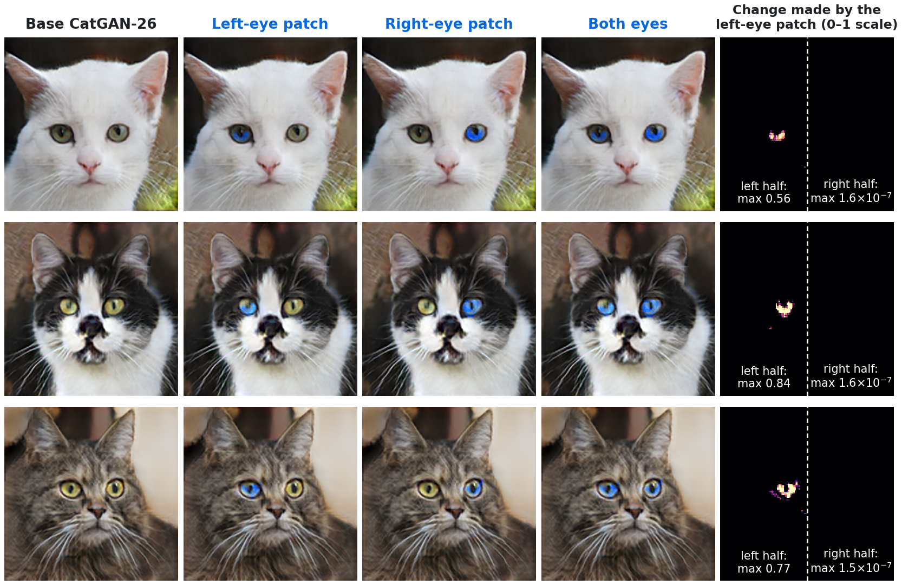
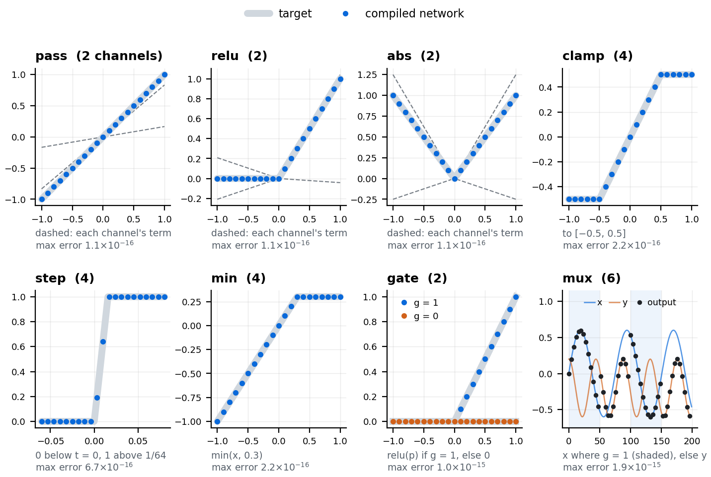
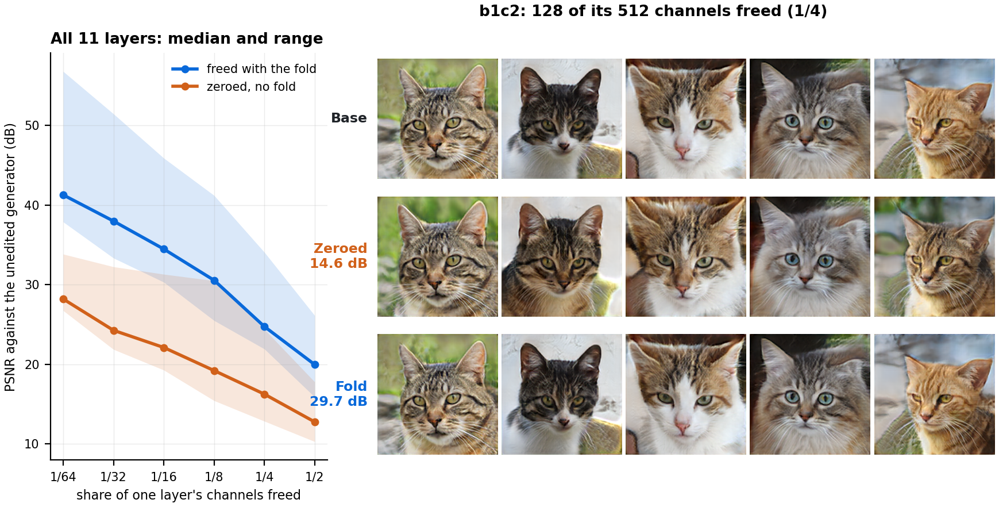
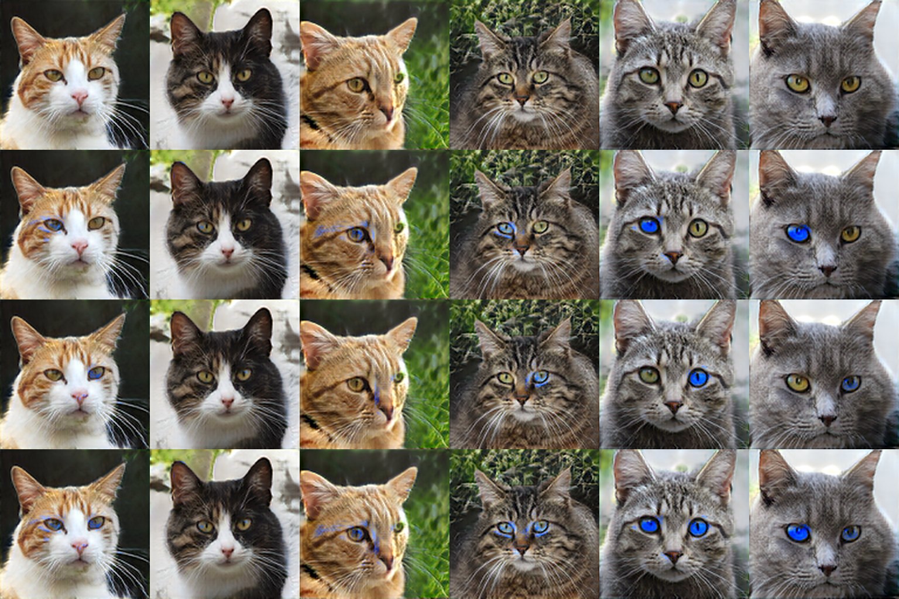
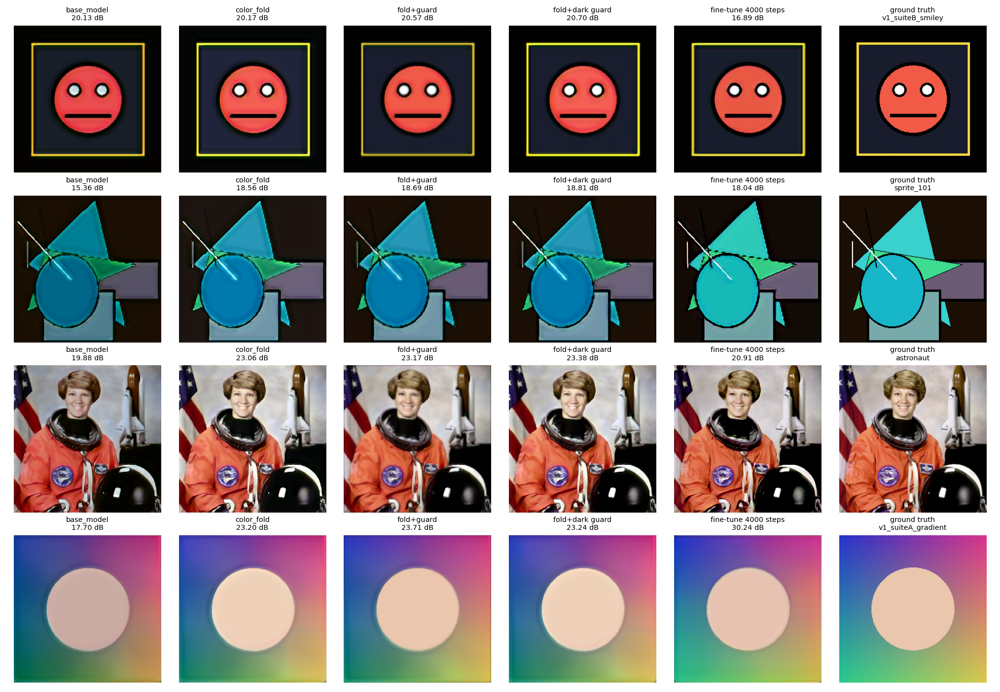
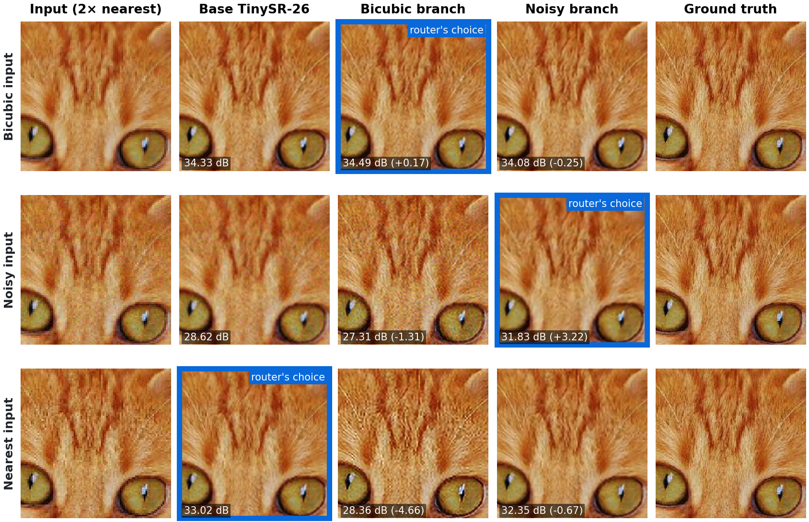
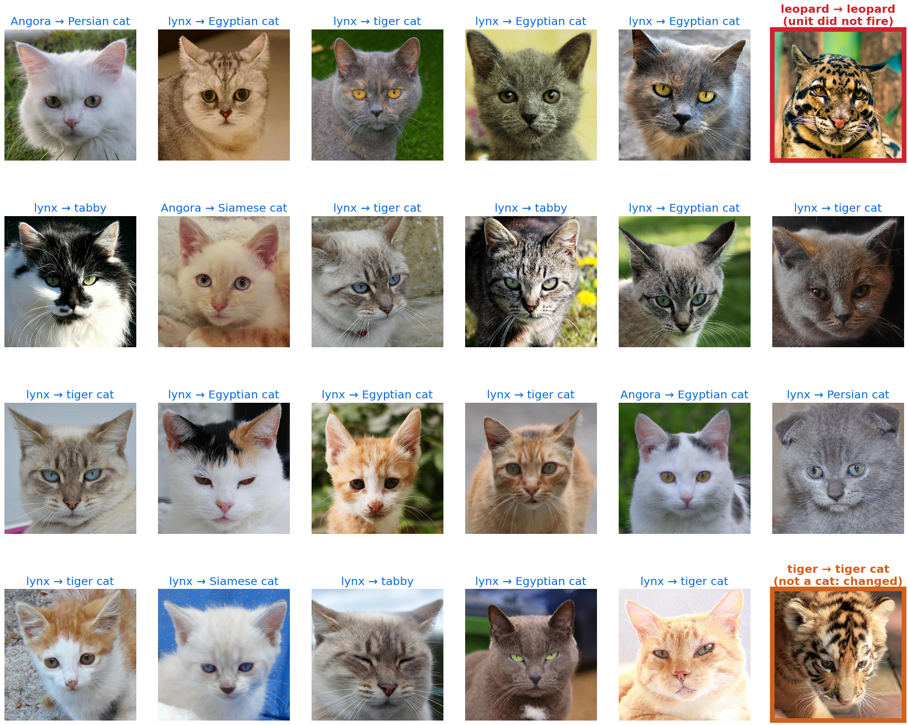

<!-- Every number traces to a file under results/ (Appendix A). Maths is LaTeX: `python paper/build_paper.py` builds wsse.html and wsse.pdf. -->

## Abstract

Gradient descent changes the values of a network's weights, inside an architecture fixed before training, toward good behaviour on the data it sees. It cannot add a unit or a connection, and what it learns holds only approximately, and only near that data. We show that a trained network can instead be *rewired* after training, and that an LLM coding agent can do the rewiring. Directed by a person, the agent (Claude Opus 5.5) writes patches for small trained models out of exact identities of the activations those models already use. With LeakyReLU or ReLU:
- two channels carry any signal through a layer unchanged, or compute an exact ReLU;
- four compute a minimum, a clamp or an OR;
- six compute a multiplexer.

The agent makes room for these circuits in one of two ways. It can regress existing channels onto the rest of their layer and fold the regression into the next layer. Or it can add channels whose outgoing weights are zero, which changes nothing.

On four small models, the agent's patches do things that training the model does not:
- **Logic in a GAN.** A coordinate wire and an AND gate compiled into an 8.1M-parameter cat generator give odd-eyed cats. 42% of left irises turn blue and no right iris changes. The right half of every image moves by at most 1.6×10⁻⁷ (float64).
- **A repair with a bound.** A 2018 super-sampler lifts black, and no output-layer patch could fix it. With a reference path and a min-gate it passes its regression gate (+3.4 dB). On any input, wherever the input is black around a pixel, the output there is provably at most 1/255.
- **Growing instead of averaging.** No weighted merge, cherry-pick or repair could combine two particular fine-tunes. Placed side by side behind a self-checking router, they keep each branch's whole gain (+0.23, +3.26, +0.00 dB): the router picks the right network for all 540 test images. That beats joint retraining (+0.03, +3.19, +0.08 dB), at three times the parameters.
- **An exception in a classifier.** One gated unit beside MobileNetV2's classifier fixes 22 of 23 misclassified cats and changes 1 of 1,000 dog and wild-animal predictions. Wherever it does not fire, the logits are exactly the original's. A quick fine-tune on the same errors turns 711 of those animals into cats. Trained by Adam on the same data, the same one-unit structure does as well: what the patch adds is the structure.

Each patch is fitted in seconds to minutes, without gradients. Patches are text files that carry their own tests, and a small tool, `wpgit`, does three things with them:
- tests each patch in the context of the others;
- finds pairs of patches whose order matters;
- rebases patches onto updated models.

On a 15-commit history of the cat generator, those checks catch failures that each patch's own tests miss. The odd-eye patch, written as grow and wiring operators, joins that history: it passes its tests next to two latent locks and commutes with them exactly. Patching does not replace training: with data in hand, a short fine-tune beats the repair above on every metric, but bounds nothing. It adds a layer on top of training, in which a trained model is a starting point that can be extended, constrained, combined and fixed. Code, patches and models are at https://github.com/v-code-895/wsse, archived at https://doi.org/10.5281/zenodo.23956114.

## 1. Introduction

A trained checkpoint is usually treated as a sealed artifact. When it misbehaves, the remedy is more data, a different loss or another training run: gradient descent is the only tool that writes the weights. That tool has fixed limits.
- It moves the values of existing parameters, inside an architecture chosen before training. It never adds a unit, a connection or a branch.
- Every step moves every output a little.
- What it learns holds approximately, on inputs like its training data. It says nothing about other inputs.

*Figure 1. Odd-eyed cats from a GAN never trained on any. The agent compiled a coordinate wire and an AND gate into CatGAN-26, an 8.1M-parameter cat generator (§4.2). Columns: the base model; a patch that turns only the left iris blue; the same patch with its logic inverted (right iris); both irises; and how much the left-eye patch changed each pixel, on a 0–1 scale, computed in float64. The change is confined to the left eye. In the right half it is at most 1.6×10⁻⁷, which is rounding error: there the gate is ANDed with a wire that is exactly 1. Of 300 held-out cats, 92 end with both irises in the blue band; these three were drawn at random from the 30 of them with the least change outside the eyes. Per eye, the gates turn 42–48% of irises blue (Table 4); Figure 6 shows less selected cats. Images upscaled 2× by TinySR-26; change maps from the 128-px outputs.*

Takehi et al. [1] showed that frontier language models can read weight tensors and write edits to them without gradients. We take the next step on small models. An LLM coding agent, directed by a person, edits not only a trained network's weights but its *topology*. It adds channels and layers, carries signals around the learned computation, and installs exact logic, guards and switches, all built from the layer types the network already has. Patches like these can do things that training a fixed architecture cannot:
- add a behaviour for which there is no training data (a generator that has never seen an odd-eyed cat draws one);
- keep a stated part of the function exactly unchanged (one half of every image; every input on which an exception does not fire);
- bound the output on every input, not only on test data;
- route between networks, so that specialisations which compete inside one fixed architecture stop competing.

**The instruction set.** The trick that makes this possible is old and small. A LeakyReLU with slope $\alpha$ satisfies
$$\text{LReLU}(u) - \text{LReLU}(-u) = (1+\alpha)\,u, \qquad \text{LReLU}(u) + \alpha\,\text{LReLU}(-u) = (1-\alpha^2)\,\text{ReLU}(u).$$
Two channels driven with opposite signs therefore carry any signal through a nonlinear layer unchanged, or turn it into an exact ReLU. Min, max, clamps, thresholds, AND, OR and a multiplexer follow, each a few channels wide (§3.1).

What remains is room, since a trained layer has no idle channels. The agent makes room in one of two ways (§3.2):
- **Freeing** channels: it regresses them onto the rest of their layer and folds the regression into the next layer.
- **Growing** the layer: it adds channels whose outgoing weights are zero, which changes nothing at all.

**Who writes the patches, and what we built around the agent.** Every patch in §4 was designed and compiled by an LLM coding agent (Claude Opus 5.5, working in Claude Code), on small models, with a person in the loop:
- **The person** states the goal and its specification, for example "one blue eye, nothing else changes", or "lower the black floor without losing 0.1 dB anywhere".
- **The agent** reads the architecture and the weights through scripts, and chooses identities and where to make room. It writes the code that compiles and fits the patch, runs the tests and looks at the images.
- **The tests decide.** A failing test goes back to the agent, which changes the patch, not the bound (§7.2).

Around the agent we built four things:
- an instruction set of identities, with exactness tests (§3.1);
- two ways to make room, with their costs measured (§3.2);
- a patch format in which every edit is a hash-pinned text file that carries its own tests (§3.3);
- `wpgit`, which tests each patch in the context of all the others, finds pairs whose order matters and rebases patches onto updated models (§3.3, §5).

The patches are small. Most of their numbers are wiring constants the agent writes by hand. The rest, such as an iris detector or a 12-number colour map, are fitted in closed form from hundreds to a few thousand examples, in seconds to minutes (Table 3).

**What we found.**
1. **Exact logic compiles into a trained GAN** (§4.2). A coordinate wire and an AND gate turn one iris blue and leave the other half of the image unchanged to float precision. Growing the room costs 0.5% more parameters and nothing in fidelity. Freeing it instead raises the mean change outside the eyes from 0.24 to 3.97 RGB levels.
2. **A rewired network repairs what output-layer edits could not, with a bound on every input** (§4.3). TinySR-18A's black lift resisted every output fold; a reference path and a min-gate pass its gate. A short fine-tune on the same images scores better and bounds nothing.
3. **Growing beats averaging for fine-tunes that compete** (§4.4). Side by side behind a self-checking router, two branches keep their whole gains, where weighted merges and joint retraining trade them off.
4. **An exception fixes a classifier locally** (§4.5). It fixes 22 of 23 errors and changes 1 of 1,000 other predictions, against 711 for a quick fine-tune. Adam can fit the same one-unit structure as well, given the same data and the right learning rate: the gain is the structure, not the absence of gradients.
5. **Patches need engineering to coexist** (§5). In a 15-commit history of the cat generator, git merges silently what the weights cannot hold together:
   - a patch that passes alone fails once merged;
   - two semantic conflicts merge without a textual conflict;
   - patches written against hidden channels go stale when the model trains further.

   In-context tests catch all of it. With a `grow` operator in the patch format, the odd-eye patch of §4.2 joins the same repository, passes its tests next to the latent locks and commutes with them exactly (§5.4).

**Contributions.**
- An instruction set for rewiring trained (Leaky)ReLU networks: exact identities that carry, gate, bound and switch signals, and two ways to make room, with exactness and cost measured on real models.
- Four agent-written patches on small trained models that do what training the model does not, each compared with fine-tuning, and the exception also with gradient descent on its own structure:
  - compiled logic (odd-eyed cats);
  - a repair with an output bound;
  - a routed union that resolves a merge conflict;
  - a local exception in a classifier.
- An account of the human–agent loop that produced them, including the proposals the tests rejected (§7.2).
- The engineering that lets many patches coexist (a self-testing text format with a grow operator for topology patches, in-context tests, semantic merge checks, rebasing) and a 15-commit case study.
- All code, patches, git histories and models.

## 2. Related work

**Weight editing and model merging.** Existing ways to change trained weights without full retraining fall into four families:
- *Learned editors.* MEND [30] trains auxiliary networks that turn a low-rank decomposition of the fine-tuning gradient into a fast weight update. Editable Neural Networks [40] meta-train a model so that later edits stay local. Text-to-LoRA [34] generates low-rank adapters from a task description.
- *Locate-then-edit and lifelong editing.*
  - ROME [2] and MEMIT [31] make closed-form updates to factual associations in a language model's layers.
  - GRACE [32] keeps a discrete codebook of edits that fire only near their keys, which our exception unit (§4.5) resembles. AlphaEdit [33] projects each update onto the null space of preserved knowledge.
  - In image generators, GANSpace [6] and InterFaceGAN [7] steer latent directions, GAN dissection [8] finds units with semantic roles, and Bau et al. [9] rewrite a generator's rules by editing a layer.
- *Task arithmetic and merging.* Task arithmetic [3] adds and subtracts fine-tuning deltas, model soups [4] average fine-tuned weights, and TIES-merging [5] resolves interference between deltas.
- *Weight-space programming.* Takehi et al. [1] showed that LLMs can tell from raw weights what a network was trained to do. In their experiments, an LLM:
  - fixes a stuck control policy by adding a separate path through a few units per layer;
  - writes game-playing networks from scratch;
  - removes a looping direction from a 0.8B-parameter language model.

  Our agent works through tools rather than in its context window. We concentrate on topology edits with exactness and bounds, and on what it takes to keep many such edits working.

Most of these change weights inside a fixed architecture; GRACE's codebook and low-rank adapters add parameters of a fixed form. The patches here change the architecture as each edit requires: they add carriers, gates, guards, units and branches, built from exact identities.

**Repair with guarantees.** Provable repair [39] solves for new weights of a ReLU network so that a specification holds on whole regions of input space, and verifiers such as Reluplex [41] check such properties. Our guards get their bound by construction instead: the bound is a wiring of exact identities, so it holds on every input and needs no solver. The price is that a guard can only bound quantities the network itself computes, such as a smoothed copy of its input. REASSURE [45] repairs a ReLU network by adding a patch network supported on the linear region of each faulty input, with guarantees of soundness, completeness, minimality and locality: outside the repaired regions the output is unchanged. Our exception unit (§4.5) is local in the same sense, exactly unchanged wherever it does not fire, but its region is a half-space of the classifier's penultimate features, fitted in closed form rather than found by solving linear programs.

**Building networks by hand.** ReLU networks compute exactly the continuous piecewise-linear functions [42], which is why min, max and gates compile exactly.
- Net2Net [35] grows a trained network wider or deeper while preserving its function, to speed up training. We use the same function-preserving growth to make room for circuits.
- CoordConv [48] gives convolutions access to position by adding coordinate channels before training. The odd-eye patch (§4.2) adds a coordinate channel to a network that is already trained, and carries it through ten layers with the `carry` identity.
- Tracr [36] compiles RASP programs [37] into transformer weights from scratch. We compile small programs into networks that are already trained, around their learned computation.
- Mixture-of-experts layers [38] route inputs between sub-networks with a trained gate. Branch-Train-Merge [46] trains domain experts separately and combines them by ensembling or parameter averaging, weighted by the input's estimated domain, and Branch-Train-MiX [47] mixes the experts' feed-forward layers into mixture-of-experts layers with a trained router. Our union (§4.4) also keeps experts separate, but routes between whole networks with a gate fitted in closed form. Routing by input statistics failed there (−0.96 dB on nearest-neighbour inputs); the router that works checks each expert's output against the input (540 of 540).

**Developing models like open-source software.** Raffel [25] proposed that pretrained models be built the way open-source software is: improved continually by a community, with the tools that make this possible. He named four open problems, and this paper bears on each.
- *Incremental, cheaply communicable updates.* Gradient descent changes every parameter, so a change to a model cannot be shipped as a small patch. Raffel pointed to function-preserving growth (Net2Net [35]), adapters and conditional computation [38] as ways around this. Our patches are of that kind: a 12-number colour fold, a rank-2 lock, or a circuit in grown channels, each stored as a few readable parameters with its tests (§3.3).
- *Merging.* Raffel expected that updates to different submodels of a model with conditional computation would not conflict. §4.4 tests this: two fine-tunes that no weighted merge could combine coexist as experts behind a router, and each keeps its whole gain. §5.2 shows the other side: edits to a shared subspace interfere, which `wpgit check` detects and orthogonalisation resolves.
- *Testing proposed changes.* Quoting Kästner [43], Raffel noted that the question is whether a model is acceptable, not whether it is correct. In our patch format each patch carries its acceptance criteria as executable tests, which state both what it must achieve and what it may not change, and `wpgit test` runs them in the context of every other patch (§3.3, §5.2).
- *Versioning and backward compatibility.* In Raffel's proposed semantic versioning, a patch release changes a small subset of parameters without degrading supported tasks, and a minor release may change the architecture while keeping most parameters. The topology patches of §4 are minor releases in this sense. Patches pin their base model by content hash, and `wpgit rebase` moves them to a new version and flags those whose context has moved (§5.3). Patches on the model's input survive 4,000 more training steps, and patches on hidden channels do not.

Git-Theta [24] brings the storage and merging layer of this agenda into git, versioning checkpoints at the level of parameters. WSSE complements it with readable patches, tests run in context and edits that change the architecture.

**Testing models.** Kästner argues that a learned model is closer to a specification than to an implementation, so the central question is validation, whether the model is the right one, rather than verification against a specification [43, 44]. Our tests follow that view: each states a requirement of one patch, such as a hue band, a 0.1 dB regression limit or a bound on the change outside the eyes, not a correct output. Behavioural testing with CheckList [26] made capability-level tests standard for language models, and Sculley et al. [27] described the technical debt that machine-learning systems accumulate. Treating weights as a data modality [28, 29] motivates the same infrastructure.

**Tools used in §5–6.** Active subspaces [10] give the subspace locks. Linear CKA [11] and model stitching [12, 13] compare and join checkpoints. Unit alignment [14] is the precondition for merging independently trained networks, and closed-form "imprinted" heads [15] add a class to a classifier.

## 3. What we built around the agent

### 3.1 An instruction set of exact identities

Each identity is one hidden layer: weights into it, the activation, weights out of it. The weights out of a layer fold into whatever linear layer follows. A circuit therefore costs channels, not layers, except where two nonlinearities must be composed. Figure 2 plots eight of them, compiled.

| identity | computes | channels | max error, float64 / float32 |
|---|---|---|---|
| `carry` | $u$, for $u \ge 0$ | 1 | 0 / 2.4×10⁻⁷ |
| `pass` | $u$ | 2 | 1.8×10⁻¹⁵ / 1.4×10⁻⁶ |
| `relu` | $\max(u, 0)$ | 2 | 8.9×10⁻¹⁶ / 1.4×10⁻⁶ |
| `abs` | $\lvert u \rvert$ | 2 | 1.8×10⁻¹⁵ / 1.1×10⁻⁶ |
| `min`, `max` | $x - \text{relu}(x - y)$, $y + \text{relu}(x - y)$ | 4 | 3.6×10⁻¹⁵ / 3.3×10⁻⁶ |
| `clamp` | $\text{lo} + \text{relu}(x - \text{lo}) - \text{relu}(x - \text{hi})$ | 4 | 2.0×10⁻¹⁵ / 1.4×10⁻⁶ |
| `step` | 0 below $t$, 1 above $t + 1/k$ | 4 | 3.7×10⁻¹⁴ / 3.1×10⁻⁵ |
| `and`, `or` | $\text{relu}(b_1 + b_2 - 1)$, $b_1 + b_2 - \text{relu}(b_1 + b_2 - 1)$ (binary $b$) | 2, 4 | 1.1×10⁻¹⁷ / 6.0×10⁻⁸ |
| `gate` | $\text{relu}(p - t - M(1 - g))$: $p - t$ where $g = 1$, 0 where $g = 0$ | 2 | 1.3×10⁻¹⁵ / 8.3×10⁻⁷ |
| `mux` | $y + \text{relu}(x - y - M(1-g)) - \text{relu}(y - x - M(1-g))$ $= g\,?\,x : y$ | 6 | 2.7×10⁻¹⁵ / 1.9×10⁻⁶ |

*Table 1. Each identity compiled into a real one-hidden-layer network with LeakyReLU 0.2 (as in CatGAN-26 and TinySR-18A) and compared with its target on 100,000 random inputs; plain ReLU (as in TinySR-26) gives equal or smaller errors. `step` is tested outside its band; `gate` and `mux` assume the big-M constant exceeds the signals they switch. `step`'s float32 error is larger because its slope ($k = 64$) amplifies rounding.*

*Figure 2. Eight identities of Table 1, each compiled into a one-hidden-layer network with LeakyReLU 0.2 and evaluated on a grid (dots), over its target (grey). The number of channels is in brackets. In the first three panels the dashed lines are the two channels' terms, whose sum is the identity. `gate` passes relu(p) where the binary signal g is 1 and outputs exactly 0 where it is 0; `mux` follows x where g = 1 (shaded) and y elsewhere. Errors are on the plotted points, in float64.*

**Topology edits that change nothing.** On CatGAN-26 (64 latents, float64):
- **Width:** adding 16 channels with arbitrary incoming weights and zero outgoing weights to every hidden convolution (8.13M → 8.72M parameters) changes the output by exactly 0.
- **Depth:** inserting a `pass` identity layer after every hidden convolution (12 → 22 weight layers) changes it by at most 9.2×10⁻⁷, the rounding of float32 weights scaled by $1/(1+\alpha)$.

**A constraint the identities impose.** `gate` and `mux` need a constant $M$ larger than the signals they switch, and $M$ must also be small enough for float precision. When the agent disabled a guard by setting its offset to $10^6$, the two large terms of the `relu` identity cancelled in float32 with errors of 0.015. An offset of 10, still above any image value, was exact to 2.5×10⁻⁶ (§7.2).

### 3.2 Making room: free or grow

**Freeing** channels $S$ of a layer regresses their activations on the remaining channels $K$ of the same layer, with a bias, using the layer's activations on sample inputs. The fitted map $B$ is folded into the next layer, and the freed channels are zeroed:
$$W'_{\cdot,\cdot,K,\cdot} = W_{\cdot,\cdot,K,\cdot} + W_{\cdot,\cdot,S,\cdot}\,B, \qquad b' = b + \textstyle\sum_{\text{taps}} W_{\cdot,\cdot,S,\cdot}\,\beta_0 .$$
- **Which channels:** the agent picks them greedily, by unexplained variance times the energy of their outgoing weights. Both come from the precision matrix of the layer's activations, refitted after each pick.
- **Where it is not exact:** freeing loses only the unexplained variance, plus a border effect where zero padding makes the constant term non-constant.

**Growing** adds channels with zero outgoing weights, which is exact (§3.1) but costs parameters.

| layer (channels) | 1/64 | 1/16 | 1/4 |
|---|---|---|---|
| dense (512) | **38.2** / 33.8 | **32.4** / 29.9 | **24.4** / 20.8 |
| b1c1 (512) | **53.9** / 26.7 | **44.9** / 22.1 | **34.1** / 15.5 |
| b1c2 (512) | **56.8** / 28.2 | **45.9** / 20.8 | **29.7** / 14.6 |
| b2c1 (256) | **50.6** / 28.2 | **37.0** / 19.3 | **21.9** / 12.8 |
| b2c2 (256) | **41.9** / 27.6 | **32.2** / 19.3 | **24.7** / 14.4 |
| b3c1 (128) | **39.2** / 26.7 | **30.3** / 19.8 | **21.9** / 14.6 |
| b3c2 (128) | **37.9** / 26.8 | **30.6** / 22.1 | **23.6** / 16.2 |
| b4c1 (64) | **41.3** / 32.9 | **33.9** / 26.1 | **24.2** / 18.8 |
| b4c2 (64) | **39.9** / 28.9 | **34.5** / 23.9 | **25.6** / 18.8 |
| b5c1 (32) | **38.2** / 30.4 | **34.8** / 28.5 | **26.1** / 19.2 |
| b5c2 (32) | **47.5** / 31.4 | **45.3** / 31.3 | **34.0** / 24.4 |

*Table 2. Room inside CatGAN-26. PSNR of the generator's images against the unedited generator's (256 held-out latents) after freeing a share of one layer's channels: **with the regression fold** / zeroed without it. Fitted on 512 other latents. A share below one channel frees one channel (the 1/64 column of the 32-channel layers). Appendix B has all six shares.*

*Figure 3. Freeing channels with and without the fold. Left: PSNR against the unedited generator after freeing a share of one layer's channels, with the regression fold (blue) or by zeroing them (orange); median and range over the 11 layers of Table 2. Right: five held-out cats after a quarter of b1c2's channels (128 of 512) are freed. Zeroed, the cats change (14.6 dB); with the fold they stay close to the base (29.7 dB). Images upscaled 2× by TinySR-26.*

- **Trained layers have spare capacity, and the fold is what recovers it** (Figure 3). Freeing 1/64 of one layer's channels with the fold leaves the images at 37.9–56.8 dB against the unedited generator, against 26.7–33.8 dB when the same channels are simply zeroed. At 1/16 the fold is worth 6–25 dB in the convolutions, but only 2.5 dB in the dense layer.
- **Room is cheapest in the widest convolutions** (b1, 512 channels: 54–57 dB at 1/64) and dearest in the dense layer, the 128-channel b3 layers and b5c1 (38–39 dB). The dense layer's 4×4 cells give the regression few samples per channel.
- **Freeing costs add up, so where exactness matters the agent grows instead.** The odd-eye wire needs one channel in each of ten layers. Freeing them left the images at 33.6 dB PSNR against the base; with the gate installed, the mean change outside the eyes was 3.97 RGB levels. Growing them added 42,548 parameters (+0.5%), left the base function intact, and cut that change to 0.24.

### 3.3 Patches, tests and `wpgit`

A **weight patch** is a text file (`.weightpatch.json`). It contains:
- the checkpoint it targets, by content hash: the first 16 hex digits of SHA-256 over the sorted tensor names and float32 bytes;
- the patches it requires;
- its operations, as compact parameters;
- its tests.

The operators of the first release act on a fixed architecture:
- latent shifts and clamps folded into the first dense layer;
- affine and spatial folds of the output layer;
- sparse diffs, for channel freeing and circuit wiring;
- dense deltas, for fine-tunes.

A 12-number colour fold rewrites 4,803 weights at build time, and a reviewer can read all 12 numbers. This version adds one topology operator, **`grow`**, which appends $k$ channels to a layer with zero incoming and outgoing weights, an exact no-op that changes layer widths. Sparse diffs later in the same patch then wire the new channels. The odd-eye patch of §4.2 is 11 grow operations and 13 sparse diffs (§5.4). The guard's inserted layers and the union's branches are still built by their scripts (§7.4).

A **weight repository** is a git repository holding only text: a `base.json` that pins the checkpoint, and the patches. `wpgit` adds what git cannot know about weights:
- **`build`** applies the patches in dependency order and refuses a checkpoint whose hash does not match.
- **`test`** runs every patch's tests *in context*: it compares the full build with the full build minus that patch and anything that requires it.
- **`check`** builds every independent pair in both orders and reports whether the pair commutes, structurally or numerically, or conflicts.
- **`rebase`** re-pins the repository to a new checkpoint. It marks a sparse diff `stale_context` when the entries it was computed against have moved, like a text diff whose context lines changed. A grown channel that reads existing channels is also marked stale when any base layer up to the one it reads from has moved (§5.4).

A textually clean merge can hide two kinds of **semantic conflict**:
- **Type I, interference:** two patches act on overlapping subspaces, so whichever runs second partly undoes the first. This can be resolved algebraically.
- **Type II, contradiction:** two patches want incompatible things. A commit must record a decision.

### 3.4 How the agent works

For each goal, the agent works through a loop:
1. **Read the model.** It reads the model's op list and probes its activations on sample inputs.
2. **Design the circuit.** It chooses where the circuit should read and write, which identities express it, and how to make room.
3. **Compile and fit.** It writes a script that compiles the wiring and fits the free numbers in closed form.
4. **Test and look.** It runs the specification test and inspects the outputs.
5. **Revise.** When a test or an image shows a problem, it changes the patch.

Every proposal and its fate are recorded in §7.2. Table 3 separates what the agent wrote by hand from what was fitted.

| patch | written by the agent as constants | fitted in closed form | room | fit time |
|---|---|---|---|---|
| odd eyes (§4.2) | 26: a 16-cell coordinate pattern, 9 copy taps, the AND weight | 293: a 289-number iris detector, its threshold, a 3-number colour | 1 channel in each of 10 layers + 2, grown | seconds per fit; 4 min with all threshold sweeps |
| guard (§4.3) | the reference path (copy taps, a 5×5 binomial kernel) and the identity weights of the min-gate | 12: a colour map and offset; 2–3 guard settings from a 30- or 36-point grid | 3 channels in each of 4 layers, grown or freed; 1–2 new layers | 11 s |
| union (§4.4) | 6 self-check features; the multiplexer | 33: a linear router | three networks side by side | 70 s, mostly running the experts on 360 fitting inputs |
| exception (§4.5) | the unit's wiring to the five cat classes | 1,281 probe weights; threshold and boost by rule | one new unit | 0.17 s |

*Table 3. What each patch is made of.*

## 4. Patches that change the architecture

### 4.1 Four small models

- **CatGAN-26** (8.1M parameters), trained for this paper on the 5,153 AFHQ cat photos [18] at 128×128. It is a DCGAN-style generator [17]: dense → 4×4×512 → five blocks of [2× nearest upsampling, two 3×3 convolutions with LeakyReLU 0.2] → output convolution. Training used a lazy R1 penalty [21], differentiable augmentation [19] and heuristics from [20], for 30,000 steps (2.9 hours on one 8 GB GPU). MobileNetV2 calls 96% of its samples domestic cats (97% for real photos), and they are no closer to their nearest training image than held-out real cats are (Appendix B).
- **TinySR-18A** (317,059 parameters), a 2× super-sampler the first author trained in 2018: five 5×5 convolutions with LeakyReLU 0.2 and nearest upsampling. It lifts black.
- **TinySR-26** (276,732 parameters), a 2× super-sampler trained for this paper: six residual blocks with ReLU [23], a sub-pixel upsampler [22] and a global bicubic skip (Figure 4).
- **MobileNetV2** [16] (3.5M parameters), the public ImageNet classifier.

*Figure 4. Three 128-px CatGAN-26 samples (left, pixel-replicated), upscaled to 512 px by bicubic interpolation (middle) and by TinySR-26 4× (right).*

### 4.2 Logic and position in a GAN: from blue eyes to odd eyes

**Blue eyes.** The first circuit was built for a 2018 anime generator (§6) and ported to CatGAN-26:
1. `prune2` frees two channels of the last hidden layer.
2. A linear iris detector reads 3×3 neighbourhoods of the layer below. It is fitted with an iris mask on fitting images only; no mask is used at run time.
3. The detector drives the two freed channels with opposite signs. By the `relu` identity, the output layer reads an exact ReLU gate, and adds an ice-blue tint only where the gate fires.

Its threshold is chosen as a CI pipeline would choose it: the strictest quantile whose result on the fitting images already passes the patch's own test (iris hue within 200–250°).
- **Results:** on 150 held-out cats it reaches a blue median hue with 23× less change outside the eyes than an ungated 1×1 colour fold (MAE 0.0059 against 0.136). Moving along a latent "towards blue" direction never reaches the eyes.
- **Per image, it is a partial success:** 40% of cats end with irises in the band, and none did before. The 3×3 linear detector fires on part of the irises and leaks onto dark tabby stripes (Figure 5).

*Figure 5. The blue-eye gate on the first four held-out cats (not selected): base (top) and with `prune2` + `eye_gate` (bottom), upscaled 4× by TinySR-26. Right: blue irises with the rest of the face unchanged. First and third: the gate does not fire. Second: it leaks blue onto a tortoiseshell's ears.*

**Odd eyes.** Convolutions are local, so nothing in a 3×3 window of features says which half of the image it is in. Only the dense layer, which has a separate bias for each 4×4 cell, can hold a spatial pattern. The agent therefore built a coordinate wire:
1. **Room.** Grow one channel in the dense layer and in each of the nine convolutions from b1c1 to b5c1.
2. **Wire.** The dense channel's bias holds RIGHT = 1 on the right two columns of the 4×4 grid and 0 on the left, with a zero kernel. Each convolution copies it with a centre tap of 1, and nearest upsampling doubles it. RIGHT ≥ 0, so `carry` passes it through every LeakyReLU exactly. At 128 px it is exactly the right-half indicator (error 0).
3. **Gate.** Grow two channels in b5c2 and install the iris gate there, fitted as before (the detector never sees the wire). The gate's pre-activation gets $-M \cdot \text{RIGHT}$, giving $\text{relu}(p - t - M\cdot\text{RIGHT})$, which is the iris gate AND NOT RIGHT. Inverting the logic to the right eye takes one sign and one bias. The gate and the output layer read the wire at their centre taps only, so the AND acts pixel by pixel.

| patch (300 held-out cats) | left irises in 200–250° | right irises in band | change outside the eyes (MAE, RGB levels) | largest change in the other half |
|---|---|---|---|---|
| base | none | none | — | — |
| **left eye only** | **42%** | **0%** | 0.24 | **1.6×10⁻⁷** (float64) |
| right eye only | 0% | 48% | 0.18 | 1.4×10⁻⁶ (float32) |
| both eyes (the gate ignores the wire) | 42% | 48% | 0.42 | — |
| left eye only, room freed instead of grown | 42% | 0% | 3.97 | — |

*Table 4. Odd-eyed cats. Shares are of cats with a visible iris on that side (274 left, 281 right). "Other half": the right half for the left-eye patch and vice versa, compared with the same network without the gate.*

*Figure 6. The odd-eye patches on the first six held-out cats where the left-eye patch changes the left eye at all, not selected for success. Rows: base; left iris; right iris; both. As with the blue-eye gate it extends, the gate fires fully on some cats (columns 5–6) and partly on others, with blue streaks on striped fur (columns 1, 3, 4).*

- **The logic is exact; the detector is not.** The AND gate makes the other half provably untouched, to float rounding (Figure 1, last column). Which irises turn blue is still decided by a fitted 3×3 linear detector, which fires on 42–48% of eyes and leaks onto striped fur (Figure 6).
- **Growing beats freeing here.** With freed room the change outside the eyes is 3.97 RGB levels, 16× the 0.24 of grown room.
- **Why not gradient descent?** Fine-tuning the generator toward odd-eyed cats would need a loss that defines them, and examples or a critic for it. It would move every output, and nothing would keep the right half fixed. The patch needs no odd-eyed data: the wire is written by hand, and the detector reuses a fit to ordinary cats.

### 4.3 A repair with a bound: TinySR-18A

**Background (v1.0 of this paper).** A static audit of TinySR-18A's weights found a positive output bias that lifts pure black (§6). A first, untested hotfix zeroed that bias and boosted high frequencies, and lost 3.50 dB. The regression gate written in response asks three things of a patch:
- on five regression images, it may lose at most 0.10 dB and 0.005 SSIM;
- on seven edge cases (sprites with black outlines, a smiley), it must gain PSNR;
- on the same edge cases, it must lower the black floor below the base's 8.90 RGB levels.

Every output-layer patch failed the gate:
- the best colour fold gains +2.93 dB but raises the black floor to 13.51;
- anchoring black destroys mid-tones (−8.98 dB).

The tone error is nonlinear, and no edit of the output layer can express its fix.

**Rewiring.** The agent kept the 12-number colour fold and added what the output layer lacked, a view of the input:
1. **Reference path.** Three channels per hidden layer carry the low-resolution image. Conv5 and conv6 copy it, the network's own nearest upsampling doubles it, conv7 smooths it with a 5×5 binomial kernel, and conv8 copies it. Images and kernels are non-negative, so `carry` passes the reference $R$ through every LeakyReLU exactly.
2. **Guard.** Conv9 now also emits $[f, -f, u, -u]$ with $u = f - R - \delta$. One new 1×1 layer computes $f - \text{relu}(u) = \min(f, R + \delta)$, where $f$ is the colour-folded output.
3. **Dark-only guard.** The plain guard also caps thin highlights (below). The second version caps only where the reference is dark: $\min\big(f,\ R + \delta + K\,\text{relu}(R - t)\big)$. It costs one more 1×1 layer and six more channels.

The guard's settings were chosen on the nine calibration images and nothing else: $\delta = 1/255$ for both guards, plus $t = 0.2$ and $K = 2$ for the dark-only guard.

| variant (TinySR-18A) | regression ΔPSNR | edge ΔPSNR | black floor (RGB) | parameters | gate |
|---|---|---|---|---|---|
| base | — | — | 8.90 | 317,059 | |
| colour fold (12 numbers, v1.0) | +2.93 | +1.81 | 13.51 | 317,059 | FAIL (black floor) |
| guard alone | −0.32 | −0.15 | 5.84 | 362,119 | FAIL (regression) |
| **colour fold + guard** | **+3.37** | **+2.02** | **7.33** | 362,119 | **PASS** |
| colour fold + guard, freed channels | +3.45 | +1.83 | 7.11 | 331,507 | PASS |
| colour fold + dark-only guard | +3.37 | +2.39 | 7.88 | 372,403 | PASS |
| colour fold + dark-only guard, freed channels | +3.43 | +2.19 | 7.61 | 341,341 | PASS |
| fine-tune all weights on the calibration images, 500 steps (76 s) | +4.34 | +2.88 | 1.62 | 317,059 | PASS |
| the same, 4,000 steps (528 s) | +5.07 | +3.63 | 2.26 | 317,059 | PASS |

*Table 5. The gate of v1.0 on rewired networks and on fine-tunes. The fine-tune uses Adam on the same nine calibration images, L1 loss with dark pixels weighted ×8; times are on a GPU shared with other jobs.*

*Figure 7. TinySR-18A outputs on a smiley, a sprite, a photo and a gradient (PSNR per image). Columns: base; the colour fold; fold + guard; fold + dark-only guard; a 4,000-step fine-tune; ground truth.*

- **The bound holds on every input.** On random noise and on calibration images, the rewired network matches $\min(f, R+\delta)$ to 2.6×10⁻⁶ and exceeds its bound by at most 3.6×10⁻⁷ (float32 rounding). The dark-only guard matches its formula to 3.1×10⁻⁶ and its bound to 7.7×10⁻⁷. Wherever the input is black around a pixel, $R = 0$ there, and the output is at most 1/255. For the dark-only guard this holds wherever the smoothed input is below 0.2 (51 levels): there the output is at most 1/255 above it. That is a statement about all inputs, not about the test images.
- **Freed channels work as well as new ones here** (+3.45 dB, PASS), with 4.6% more parameters instead of 14%. Only the guard's own output channels and layer are new.
- **The plain guard has a cost the gate barely sees.** It caps every pixel, so thin bright lines are dimmed toward the smoothed reference (Figure 7: the smiley's border). The dark-only guard leaves highlights alone and gains more on the edge cases (+2.39 against +2.02 dB), at a slightly higher black floor (7.88 against 7.33).
- **Fine-tuning does better, and bounds nothing.** With the same nine images, 500 Adam steps pass the gate with a black floor of 1.62. But the verdict flips between checkpoints: 250 and 1,250 steps fail. A first run with the same seed failed at 250 and 750 steps instead, because GPU training here is not bit-reproducible (Appendix B). The fine-tune changes all 317,059 weights, and nothing bounds its output on other inputs. The patch is 12 fitted numbers, two chosen settings, a wiring and a stated bound. The two also compose: a guard can be added on top of a fine-tune.

### 4.4 Grow instead of average: resolving a merge conflict

**The conflict (v1.0).** Two branches were fine-tuned for 3,000 steps each from TinySR-26:
- **bicubic**, which should be better on bicubic-downsampled inputs;
- **noisy**, which should be better on noisy inputs.

Stored as weight deltas, they merge by addition. The merge commutes exactly, and the deltas are nearly orthogonal (cosine 0.088). The merge's specification is a test: both claims hold, and no test falls more than 0.1 dB below the base. Every weight-space resolution failed it:
- 25 weightings $W_0 + a\Delta_{\text{bicubic}} + b\Delta_{\text{noisy}}$;
- cherry-picking layers, after a blame showed the regression spread over the whole network;
- a 1,000-step repair fine-tune.

Only joint retraining on both objectives passed. Within one network of fixed size, specialising for bicubic inputs and staying robust to nearest-neighbour inputs compete.

**The union.** The agent kept all three networks (base, bicubic branch, noisy branch) side by side, so each keeps its exact function. It added a router that picks one per image, and combined the outputs with two `mux` identities.
- **First router: input statistics.** It used eight mean filter energies of the input, at two scales. It reached 81% on the fitting images. On the test set it sent 30 of 180 nearest-neighbour inputs to the bicubic branch, which costs 4.9 dB on each of them, and the union failed (−0.96 dB).
- **Second router: self-consistency.** Each expert's output is degraded again, by nearest-neighbour sampling and by antialiased bicubic downsampling, and compared with the input: six mean differences. The expert that agrees with the input under the right degradation wins. These features are strided convolutions, `abs` and one global average, so the router compiles with the same identities. It classified all 360 fitting inputs correctly.

PSNR change against the base (dB) on 180 held-out AFHQ photos per input type (2×, 256 → 512 px):

| model | bicubic inputs | noisy inputs | nearest inputs | parameters | meets spec |
|---|---|---|---|---|---|
| branch: bicubic | +0.23 | −0.47 | −4.88 | 276,732 | no |
| branch: noisy | −0.20 | +3.26 | −1.01 | 276,732 | no |
| merge: base + both deltas | −0.03 | +2.56 | −4.06 | 276,732 | no |
| 25 weightings, cherry-picks, a 1,000-step repair (v1.0) | | | | 276,732 | none |
| joint retraining, 3,000 steps from the base | +0.03 | +3.19 | +0.08 | 276,732 | yes |
| union, router on input statistics | +0.21 | +2.69 | −0.96 | 830,196 + 43 | no |
| **union, self-consistency router** | **+0.23** | **+3.26** | **+0.00** | 830,196 + 33 | **yes** |

*Table 6. Resolving the merge conflict. The self-consistency router chose the right network for all 540 test images.*

*Figure 8. One held-out photo, downsampled three ways and upscaled 2× by each network in the union: crops of the 512-px outputs, with the PSNR of the whole image and its change against the base. Each branch helps only on its own input type, and the bicubic branch rings on nearest-neighbour inputs (−4.66 dB here). The self-consistency router (blue frame) picks the right network for each input, as it did for all 540 test images, and the multiplexers pass that network's output through unchanged.*

- **The union keeps both branches' whole gains**, equal to the best single network on each input type (Figure 8). It beats joint retraining on bicubic inputs (+0.23 against +0.03 dB).
- **The switch is exact:** the two multiplexers match plain selection to 6×10⁻⁸.
- **What it costs:** three networks' parameters, and, because the self-check needs every expert's output, three networks' compute. Joint retraining is compact but trades the bicubic gain away.
- **Why gradient descent could not:** gradient descent on the fixed architecture had to find one set of weights for both tasks. Growth removes that constraint. Like a mixture of experts [38], the union routes between networks, but no expert is retrained and the gate is 33 numbers fitted in closed form.

### 4.5 An exception in a classifier

**Specification.** An AFHQ cat photo should get a domestic-cat class (ImageNet 281–285) as MobileNetV2's top-1, and dog and wild-animal photos (lions, tigers, leopards, foxes, wolves) must keep their predictions. MobileNetV2 gets 23 of 500 validation cats wrong: 19 are called "lynx", 3 "Angora" and 1 "leopard".

**Patch.** The agent added one ReLU unit beside the linear classifier, a new branch:
$$\text{logits}' = \text{logits} + \beta\;\text{relu}(w \cdot \phi + c - \theta)\;\mathbf{1}_{\text{cats}},$$
where $\phi$ is the 1,280-dimensional pooled feature. Its numbers are fitted on 600 AFHQ training images per class:
- $w$ and $c$: a ridge probe for "cat photo or not";
- $\theta$: the smallest threshold that fires on no fitting dog or wild animal;
- $\beta$: the smallest boost that fixes the fitting errors on which the unit fires (all 45).

The patch adds 1,287 parameters and is fitted in 0.17 s.

| fix (500 validation images per class) | cat errors fixed | correct cats broken | dog predictions changed | wild predictions changed (now "cat") | KL from base: dogs / wild | fit time |
|---|---|---|---|---|---|---|
| **exception unit, fitted in closed form** | **22/23** | 0 | **0** | **1 (1)** | **0.0001 / 0.0004** | 0.17 s |
| the same unit trained by Adam, preservation loss, lr 10⁻² | 22/23 | 0 | 0 | 0 | 0.00003 / 0.0002 | 0.6 s |
| the same unit trained by Adam, preservation loss, lr 10⁻³ | 22/23 | 0 | 0 | 3 (3) | 0.0013 / 0.0038 | 0.6 s |
| the same unit trained by Adam, errors only, lr 10⁻³ | 23/23 | 0 | 166 (166 now "cat") | 145 (145) | 0.59 / 1.01 | 0.5 s |
| head fine-tune with a preservation loss | 22/23 | 0 | 2 | 2 (1) | 0.0007 / 0.0017 | 1.5 s |
| head fine-tune on the errors only | 23/23 | 0 | 377 (375 now "cat") | 338 (336) | 2.27 / 2.24 | 0.9 s |

*Table 7. Fixing MobileNetV2's cat errors. Every gradient-trained row uses Adam for 300 steps on the same fitting images, either on the classifier's 1.28M weights (head) or on the exception unit's 1,281 input and 5 output weights, starting from small random input weights and zero output weights. The preservation loss is the KL from the base predictions on the fitting dogs and wild animals. Trained on the errors only at lr 10⁻², the unit fires on every image and turns 999 of 1,000 animals into cats.*

*Figure 9. All 23 validation cats that MobileNetV2 gets wrong, labelled with its top-1 class before → after the exception unit. ImageNet's "tiger cat", "tabby", "Egyptian cat", "Persian cat" and "Siamese cat" are domestic-cat classes. The unit fixes 22. The one it leaves (red) is not a domestic cat but a wild cat, apparently a clouded leopard, that AFHQ files under cats; the unit does not fire on it. Last (orange): the one dog or wild-animal prediction of 1,000 that the patch changed, a tiger cub now called "tiger cat".*

- **Exactly local where it is off.** The unit fired on 499 cats, 73 dogs and 33 wild animals. On the other 894 dogs and wild animals the logits are the base model's exactly (largest change 0.0). Of the 106 non-cats on which it fired, one changed its prediction.
- **The one cat error it leaves is a labelling error.** AFHQ files a wild cat, apparently a clouded leopard, under cats; MobileNetV2 calls it a leopard, and the unit, fitted to stay off on wild animals, stays off (Figure 9).
- **The threshold does not stop the unit firing on new non-cats.** It was fitted on 1,200 of them, so the guarantee is local behaviour where the unit is off, plus a network that reports when it has fired, not silence on every non-cat.
- **A careful fine-tune matches the fixes and drifts more** (4–8× the KL, four changed predictions). A quick one is a disaster: it turns 711 of 1,000 dogs and wild animals into cats.
- **Gradient descent on the same structure does as well, with care.** Trained by Adam with the preservation loss at lr 10⁻², the same one-unit branch fixes the same 22 errors, changes no dog or wild-animal prediction and fires on 50 of the 1,000, against 106 for the closed-form unit. At lr 10⁻³ it fires on 975 of them and changes three. Trained on the errors alone, it turns 311 (lr 10⁻³) to 999 (lr 10⁻²) of the 1,000 animals into cats. The closed-form rule needs no learning rate, and its threshold keeps the unit silent on all 1,200 fitting non-cats; the best Adam-trained unit fires on 60 of them. What the patch adds is the structure, a unit beside the classifier that is exactly silent where it is off. Gradient descent on the trained classifier cannot add that unit; once it is there, gradient descent can fit it.

## 5. Keeping many patches working

The patches of §4 were each tested alone. Models in use collect many edits from several authors over time, and the tests of single patches are not enough. This section is the v1.0 case study: a 15-commit git history of patches on CatGAN-26, built with the fixed-architecture operators of §3.3. The tests and their bounds were written for a 2018 anime generator (§6) and reused unchanged, except the eye-hue band. §5.4 then brings a topology patch from §4 into the same repository.

*Figure 10. CatGAN-26 through successive builds of its weight repository: base; the blue-eye circuit (`prune2`, `eye_gate`); a rank-2 lock on fur lightness; HEAD, with a background lock, where every test passes. Images upscaled 4× by TinySR-26. Same random latents in every row.*

### 5.1 Fix the patch, not the test: subspace locks

A `latent_clamp` pins the latent's coordinate along a fitted attribute direction, so the attribute should stop varying. On CatGAN-26 it does not. The attributes are only partly linear in the latent (held-out $R^2$ 0.32–0.66), and a one-direction lock leaves 72% of fur-lightness variance and 43% of background variance; the test bound is 30%.

A **rank-$k$ subspace lock** clamps $k$ orthonormal directions:
- the fitted direction, with its target;
- then, one at a time, the top eigenvector of $\mathbb{E}[gg^\top]$, where $g$ is the attribute's gradient at already-clamped latents (an active subspace [10]), clamped to the latent mean.

The rank is the smallest that reaches 0.2 on selection latents.

| lock | rank 1 | rank 2 | rank 3 | rank 8 | random second direction |
|---|---|---|---|---|---|
| fur lightness | 0.72 | **0.19** | 0.05 | 0.01 | 0.72 |
| background | 0.43 | **0.18** | 0.12 | 0.01 | 0.43 |

*Table 8. Variance of the locked attribute relative to the base model (bound 0.3). The folded patch equals the latent edit to 4.1×10⁻⁶.*

One targeted extra direction is enough; a random one does nothing. The price is diversity. Every cat is moved to light fur, and feature diversity falls from 0.94 to 0.78.

*Figure 11. The same eight latents under one-direction (rank 1) and rank-2 locks. The rank-1 fur-lightness lock still lets a black cat through; at rank 2 every cat is light.*

### 5.2 Fifteen commits

A script builds the history and records every command. Its findings:
1. **Three feature branches merge cleanly:** warm fur, bright background and blue eyes. `wpgit check` finds no conflicts.
2. **One patch fails only in context.** In the merged build, the warm-fur shift moves fur warmth by +0.92 SD (its test asks for at least 1.0) and the background by −0.55 SD (the guard allows ±0.3). Alone it gave +1.25 and −0.13 SD and passed: combined with the background shift, the generator's nonlinearity couples the two. `git revert` of the warm-fur merge reproduces a direct build of the remaining patches bit for bit.
3. **Two lock branches merge without a textual conflict, and `wpgit check` reports three semantic conflicts.**
   - **Type I:** the locks' subspaces overlap, so their order changes the model (output MAE 0.129). Gram–Schmidt orthogonalisation with recomputed targets makes them commute to 2.4×10⁻⁷.
   - **Type II:** the background lock freezes the background that the bright-background shift moves. A commit records that the lock supersedes the shift, which also removes the third conflict.
4. **HEAD passes every test.** With the one-direction locks of 2018, the same history fails at HEAD (variance ratios 0.708 and 0.677). With rank-2 subspace locks it passes (0.101 and 0.114), and the eye hue is 224.6°.

The patches at HEAD are 88 KB of text on a 32.5 MB model.

### 5.3 When the base model changes: rebasing

We trained CatGAN-26 4,000 more steps, from its full training state, and moved the repository onto each new checkpoint with `wpgit rebase`. The same tests then ran.

| upstream | output change (MAE) | stale patches flagged | `prune2` / `eye_gate` change outside the eyes (≤ 0.015) | fur / background lock (≤ 0.3) | all tests |
|---|---|---|---|---|---|
| +500 steps | 0.045 | `prune2`, `eye_gate` | 0.006 / 0.005 | 0.104 / 0.109 | pass |
| +1,000 | 0.067 | both | 0.009 / 0.009 | 0.112 / 0.127 | pass |
| +2,000 | 0.094 | both | **0.024 / 0.024** | 0.154 / 0.134 | fail |
| +4,000 | 0.127 | both | **0.025 / 0.025** | 0.161 / 0.294 | fail |

*Table 9. Rebasing the cat repository onto further-trained versions of CatGAN-26.*

- **Patches written against an interface survive; patches written against an implementation do not.**
  - The locks act on the latent, the model's input, and hold through 4,000 steps.
  - `prune2` stores a difference computed on the old weights, so on new weights it leaves residue in the "freed" channels, which the gate then writes into.
- **The stale-context check fires before any test fails:** at +500 steps, against the tests' first failure at +2,000.
- **Regenerating instead of porting.** Re-running the fitting scripts on the +4,000 checkpoint took 11 minutes with no manual changes. It restores each patch's guarantees, but at HEAD the regenerated gate stops firing (hue 26°). Its threshold sits one step from a cliff, and locking every cat to light fur pushes the detector's scores past it. Only an in-context test sees this.

The same lesson applies to §4's circuits. They read and write specific hidden channels, so they are implementation patches. After an upstream update they must be refitted, not ported, and then retested in context.

### 5.4 A topology patch in the repository

With the `grow` operator (§3.3), the odd-eye patch of §4.2 becomes one `.weightpatch` file: 11 grow operations, then 13 sparse diffs that wire the new channels (603 entries, 42,548 new parameters). `wpgit build` reproduces the network of §4.2 exactly. In a branch of the cat repository at HEAD, the patch replaces the 2018-style blue-eye circuit (`prune2`, `eye_gate`) and sits next to the two rank-2 locks. Its tests are the specification of §4.2: at least 30% of left irises end in the 200–250° band, no right iris does, the right half of every image is unchanged, and the change outside the eyes stays below 0.015.

- **It passes its tests in context.** Each test compares the full build with the build without the patch, so it runs on cats whose fur and background are locked. On 150 test latents, 34% of left irises end in the band, no right iris does, the right half changes by at most 2.9×10⁻⁶ (float32 rounding; the bound is 10⁻⁵) and the rest of the image by 1.2×10⁻⁴ on average. Both locks still pass (variance ratios 0.099 and 0.114, against 0.3).
- **It commutes with the locks exactly.** The grow operations and the locks both write the dense layer, so `wpgit check` builds both orders. The locks act on the dense layer's input side, the latent; the wire adds new output columns, which a lock leaves at zero. The two orders give identical weights (difference 0).
- **Rebase needs a wider notion of context.** A grown channel writes only new entries, which no upstream update can move, so the rule that caught `prune2` (§5.3) would never fire. But the iris gate reads existing b5c1 features. `wpgit rebase` therefore treats every base layer up to the one a grown channel reads from as that channel's context. The further-trained checkpoints of §5.3 were not kept, so we checked the rule on two synthetic updates: scaling the output layer's kernel by 0.1% leaves the patch clean, and scaling b3c1's kernel by 0.1% marks it stale. The wire reads only its own carriers, so on its own, like the locks, it would be an interface patch.

The two halves of this paper meet here: a patch that changes the architecture is versioned, tested in context and merge-checked like the fixed-architecture patches around it.

## 6. Old checkpoints as legacy code

The toolkit started on checkpoints the first author trained in 2017–2020, in Keras 2. They have no tests or documentation, and in places they have bugs:
- TinySR-18A and TinySR-18B (2× super-samplers);
- Anime-DCGAN;
- Cat-GAN and PCA-GAN;
- Recycle-Bot (a trash classifier).

The public MobileNetV2 is treated the same way.

**Reading weights without running them.**
- **A defect.** A static audit finds TinySR-18A's positive output bias (0.090, 0.046, 0.034), the defect repaired in §4.3.
- **Training history.**
  - Recycle-Bot's BatchNorm running variance (median 0.8347 ≈ $0.99^{18}$) gives its training length: 18 steps, which the notebook confirms.
  - MobileNetV2's first BatchNorm mean equals its filter sums times the training set's mean colour, since Conv1 has no bias. Solving for the colour recovers the ImageNet mean to within 1.4 levels.
- **Shared ancestry.** Cat-GAN and PCA-GAN share an architecture and a dataset, but their tensors correlate near zero. They share no root commit, so no patch transfers between them until their units are aligned [14].

**Exact refactors.**

| model | refactor | parameters | max output difference |
|---|---|---|---|
| Recycle-Bot | fold 5 BatchNorms; collapse a linear–Dropout–linear head | 741,121 → 151,809 | 2.9 × 10⁻⁶ |
| MobileNetV2 | fold all 52 BatchNorms | 3,538,984 → 3,487,816 | 5.5 × 10⁻⁵ (logits) |
| MobileNetV2 | fold uint8 preprocessing into Conv1, with a padding value of 127.5 | unchanged | 2.5 × 10⁻⁵ |
| Anime-DCGAN | exact mirror and 90° rotation by kernel permutation | unchanged | 1.3 × 10⁻⁶ |

*Table 10. Exact refactors. Folding the preprocessing is exact only once the padding value is part of the patch: zero padding in [−1, 1] space is 127.5 in raw pixels.*

**Stitching.** TinySR-18A and TinySR-18B have different widths and kernel sizes, yet their hidden layers align (linear CKA 0.68–0.86 [11]). A fitted 1×1 map folded between the front of one and the back of the other gives an exact hybrid with no adapter layers [12, 13]. One hybrid beats both parents on natural images (23.71 against 22.75 and 22.31 dB).

**Where the circuits came from.** The latent operators, the gated eye circuit and the git workflow were first built for Anime-DCGAN (252,931 parameters, 2018). They ran on CatGAN-26, which is 32× larger, unchanged apart from two backward-compatible parameters (Figure 12). A closed-form "anime face" class appended to MobileNetV2 [15] serves as a test oracle for that generator's edits. It recognises 100% of held-out generated faces with 0% false positives.

*Figure 12. Anime-DCGAN samples (64 px, 2018, top), on which the latent operators, the eye circuit and the git workflow were first built, and CatGAN-26 samples (128 px, 2026, bottom).*

## 7. Discussion

### 7.1 What a trained model becomes when it can be patched

Gradient descent and patching write to different parts of a network. Gradient descent writes **values**, the weights of a fixed graph, toward lower loss on its data. The patches in §4 write **structure**: new channels, carriers, gates, guards, branches and switches, built from identities that are exact on every input. That gives them properties training does not have:
- **New structure.** A coordinate wire, a reference path, a second and third network, a new unit.
- **Exact invariance of chosen parts.** The other half of the image; every input on which an exception is off.
- **Bounds on every input.** The guard.
- **Discrete decisions.** Switches with no blending between experts.
- **Behaviour without data for it.** No odd-eyed cat was needed.

**Is this a starting point?** In a specific sense, yes. Training produces features; patches compose new behaviour on top of them, as programs build on a library. Every patch in §4 reuses learned computation:
- the iris gate reads learned features;
- the guard caps the learned output;
- the router compares the experts' own outputs;
- the exception reads the classifier's penultimate features.

Patches cannot create features the network lacks. The guard bounds TinySR-18A's tone error; only the fine-tune learns to correct it. A trained model therefore becomes something like a compiled library that can still be extended after release:
- extended, with new capabilities;
- constrained, with bounds and invariances;
- combined, with routing;
- fixed, with local exceptions;
- maintained, with tests and rebases (§5).

**What this unlocks next.**
- *Verified detectors.* The weak part of every circuit is a fitted detector (42–48% of irises). Verifiers [41] and provable repair [39] could certify the detectors, as the identities already certify the wiring.
- *Topology in the patch format.* Growth is now an operator (§5.4); insert and branch operators would bring the guard and the union under `wpgit` too.
- *Larger models.* The identities need piecewise-linear activations. The GELU and SwiGLU of most language models are not piecewise linear, so exact circuits there must be added beside them, as ReLU units in grown room. The union and exception patterns need only a linear readout.
- *Agents writing weights in context.* Takehi et al. [1] show LLMs writing weights directly. A shared instruction set and tests would let such edits be checked and kept.

### 7.2 The human–agent loop, proposal by proposal

The bottleneck in maintaining a model through patches is not the linear algebra. It is the loop around it:
1. propose an edit;
2. find out what it breaks;
3. decide whether to change the patch, resolve a conflict or reject the change.

The person set goals and specifications. The agent wrote the fitting and compiling code, proposed patches and ran the tests; the first, untested TinySR-18A hotfix predates this workflow. Every row below is a proposal that ran without error and looked reasonable when written; a measurement stopped it.

| proposal | what caught it | outcome | resolution |
|---|---|---|---|
| TinySR-18A hotfix: zero the output bias, boost high frequencies | regression gate | −3.50 dB | zeroing the bias alone costs −3.51 dB; rejected |
| four exact output folds | regression gate | 0 of 4 pass | the tone error is nonlinear; rewired instead (§4.3) |
| guard with a cap at $R + \delta$ everywhere | looking at the images | thin bright lines dimmed | dark-only guard: edge +2.39 against +2.02 dB |
| disable the guard with $\delta = 10^6$ to check the grown network | the identity check itself | float32 cancellation, error 0.015 | big-M constants sized to the signal ($\delta = 10$): error 2.5×10⁻⁶ |
| first run of the guard experiment | base numbers ≠ v1.0 (black floor 10.85 against 8.90) | wrong downsampling filter | v1.0's gate uses nearest-neighbour inputs; rerun |
| free one channel per layer for the odd-eye wire | change outside the eyes | 3.97 RGB levels | grow the room instead: 0.24 |
| median iris hue as the odd-eye metric | inconsistent with per-image counts | median 92° with 42% of eyes in band | report the share of eyes in band |
| route the union by input statistics | router accuracy, then the spec test | 81%; −0.96 dB on nearest inputs | self-consistency router: 540 of 540 |
| quick fine-tune on the classifier's errors | collateral on non-cats | 711 of 1,000 animals become cats | the exception unit (one change) |
| CatGAN-26 with a spectral-normalised discriminator | training diagnostics | all inputs scored −0.0024 ± 0.00003 | R1 penalty and He initialisation |
| latent shifts orthogonalised against all attributes | on-target measurement | fur warmth erased (cos 0.951 with saturation) | keep near-duplicates |
| one-direction latent locks | `wpgit test` at HEAD | 0.708, 0.677 against 0.3 | bound kept; rank-2 subspace locks |
| 29 weight-space resolutions of the fine-tune merge | the merge's specification test | none passes | joint retraining (v1.0); a routed union (§4.4) |
| porting the cat repository after 4,000 more training steps | `wpgit rebase`, then `wpgit test` | channel patches stale, then failing | regenerate, then retest in context |

*Table 11. What the agent proposed, and what stopped it.*

### 7.3 What gradient descent still does better

- **Learning features.** With data in hand, a short fine-tune beat the TinySR-18A repair on every metric (Table 5). Patches compose behaviour from features the network already has.
- **Compactness.** Joint retraining resolves the merge conflict at one network's size; the union needs three.
- **Detectors.** Every circuit contains a fitted detector, and fitted detectors are imperfect: 42–48% of irises, blue streaks on fur, an exception unit that fires on 106 non-cats.
- **Composition without tests.** Patches interact, merge silently into conflicts and go stale (§5). Gradient descent at least optimises everything jointly.
- **Fitting a given structure.** Given the exception unit's structure and the same data, Adam fits it as well as the closed-form rule, if the learning rate is right (§4.5). The patches' advantage is their structure, not the absence of gradients.

The two are complementary. A fine-tune can be guarded, an exception can sit on a fine-tuned head, and a union can hold networks that were each trained well.

### 7.4 Limitations

- **Scale.** The models have 0.25M–8.1M parameters. The identities are exact at any size, but we have not tested circuits in large models or in transformers.
- **Small and partly synthetic tests.** Generator attributes are pixel heuristics. The TinySR-18A gate uses 5 regression and 7 edge-case images, and its guard was calibrated on 9. Each 2026 model was trained once, with one seed.
- **Only growth is an operator.** The odd-eye patch is versioned, tested and merge-checked by `wpgit` (§5.4), and its rebase rule was checked only on synthetic updates. The guard's inserted layers and the union's branches are still built and tested by their scripts.
- **Choices made after failures.** Several patches were changed after a test failed (Table 11). Every choice was made on fitting or calibration data, and the earlier versions are reported.
- **The agent works through tools.** The agent wrote code that computes the patches; it did not write raw weights in its context window, as in [1]. The constants it wrote by hand (Table 3) are wiring, not learned values.
- **Environment.** The synthetic sprite tests are drawn with Pillow, whose rasteriser changed between versions. All numbers come from the pinned environment (Appendix A).

### 7.5 Lessons

1. **Grow when exactness matters, free when parameters matter.** Growing is exact (§3.2); freeing costs fidelity, and those costs add up.
2. **Make logic exact and keep the learned parts small.** Exact wiring turns a fitted detector's mistakes into the only mistakes, and makes them visible.
3. **Bound what you can compute.** A guard needs a reference inside the network; the reference path supplies one.
4. **Route instead of averaging when objectives compete,** and let the experts check themselves.
5. **Test in context, keep the specification and change the patch.** Every row of Table 11 was stopped by a measurement, and none by a looser bound.

## 8. Conclusion

A trained network does not have to be a sealed artifact. With a handful of exact identities of the activations it already uses, an LLM agent can rewire it after training:
- carry a coordinate through ten layers, and AND it with a fitted detector;
- give a model a view of its own input, and bound its output by it;
- put competing networks side by side behind a self-checking switch;
- add an exception that is exactly silent where it does not fire.

Each patch is fitted in seconds to minutes from hundreds to a few thousand examples, and none is something gradient descent would write into the trained model's fixed architecture. Given a patch's structure, gradient descent can fit its parts, as it fits the exception unit: the structure is what the agent adds. They do not replace training, which still learns the features and wins when data is plentiful. They add a layer on top of it, and that layer needs software engineering: tests run in context, merge checks and rebases.

## Author contributions and AI disclosure

- **Voravee Upatising** trained the 2017–2020 checkpoints and conceived weight-space software engineering as a research direction. Voravee Upatising directed the work: set the questions, the goals and the specifications of every experiment, chose which results to pursue, asked for the topology and patching experiments of §3–4, and is responsible for the content of the paper.
- **Claude** (Anthropic; model Claude Opus 5.5), an AI system, is the agent the paper describes. Under Voravee Upatising's direction it wrote the code, including:
  - the NumPy engine and `wpgit`;
  - the experiment scripts;
  - the training code for TinySR-26 and CatGAN-26;
  - the circuit library.

  It designed and compiled the patches of §4, ran the experiments, analysed the results and drafted much of the text.
- Voravee Upatising lists Claude as a co-author to state its contribution plainly. Claude cannot take responsibility for the work in the way a human author can. Venues whose policies do not allow AI authors should read this paper as authored by Voravee Upatising, with Claude's contribution acknowledged here.

## References

[1] R. Takehi, J. Teoh, A. Zhang, O. Khattab (MIT CSAIL). Sparks of Weight-Space Programming: LLMs can natively read & write neural network weights. Blog post, November 2, 2026. https://rikiyat.github.io/blog/weight-space-programming/

[2] K. Meng, D. Bau, A. Andonian, Y. Belinkov. Locating and Editing Factual Associations in GPT. NeurIPS 2022.

[3] G. Ilharco, M. T. Ribeiro, M. Wortsman, S. Gururangan, L. Schmidt, H. Hajishirzi, A. Farhadi. Editing Models with Task Arithmetic. ICLR 2023.

[4] M. Wortsman, G. Ilharco, S. Y. Gadre, R. Roelofs, R. Gontijo-Lopes, A. S. Morcos, H. Namkoong, A. Farhadi, Y. Carmon, S. Kornblith, L. Schmidt. Model Soups: Averaging Weights of Multiple Fine-Tuned Models Improves Accuracy without Increasing Inference Time. ICML 2022.

[5] P. Yadav, D. Tam, L. Choshen, C. Raffel, M. Bansal. TIES-Merging: Resolving Interference When Merging Models. NeurIPS 2023.

[6] E. Härkönen, A. Hertzmann, J. Lehtinen, S. Paris. GANSpace: Discovering Interpretable GAN Controls. NeurIPS 2020.

[7] Y. Shen, J. Gu, X. Tang, B. Zhou. Interpreting the Latent Space of GANs for Semantic Face Editing. CVPR 2020.

[8] D. Bau, J.-Y. Zhu, H. Strobelt, B. Zhou, J. B. Tenenbaum, W. T. Freeman, A. Torralba. GAN Dissection: Visualizing and Understanding Generative Adversarial Networks. ICLR 2019.

[9] D. Bau, S. Liu, T. Wang, J.-Y. Zhu, A. Torralba. Rewriting a Deep Generative Model. ECCV 2020.

[10] P. G. Constantine, E. Dow, Q. Wang. Active Subspace Methods in Theory and Practice: Applications to Kriging Surfaces. SIAM Journal on Scientific Computing 36(4), A1500–A1524, 2014.

[11] S. Kornblith, M. Norouzi, H. Lee, G. Hinton. Similarity of Neural Network Representations Revisited. ICML 2019.

[12] K. Lenc, A. Vedaldi. Understanding Image Representations by Measuring Their Equivariance and Equivalence. CVPR 2015.

[13] Y. Bansal, P. Nakkiran, B. Barak. Revisiting Model Stitching to Compare Neural Representations. NeurIPS 2021.

[14] S. Ainsworth, J. Hayase, S. Srinivasa. Git Re-Basin: Merging Models modulo Permutation Symmetries. ICLR 2023.

[15] H. Qi, M. Brown, D. Lowe. Low-Shot Learning with Imprinted Weights. CVPR 2018.

[16] M. Sandler, A. Howard, M. Zhu, A. Zhmoginov, L.-C. Chen. MobileNetV2: Inverted Residuals and Linear Bottlenecks. CVPR 2018.

[17] A. Radford, L. Metz, S. Chintala. Unsupervised Representation Learning with Deep Convolutional Generative Adversarial Networks. ICLR 2016.

[18] Y. Choi, Y. Uh, J. Yoo, J.-W. Ha. StarGAN v2: Diverse Image Synthesis for Multiple Domains. CVPR 2020, pp. 8188–8197. (AFHQ dataset, CC BY-NC 4.0, NAVER Corporation.)

[19] S. Zhao, Z. Liu, J. Lin, J.-Y. Zhu, S. Han. Differentiable Augmentation for Data-Efficient GAN Training. NeurIPS 2020.

[20] T. Karras, M. Aittala, J. Hellsten, S. Laine, J. Lehtinen, T. Aila. Training Generative Adversarial Networks with Limited Data. NeurIPS 2020.

[21] L. Mescheder, A. Geiger, S. Nowozin. Which Training Methods for GANs do actually Converge? ICML 2018, PMLR 80:3481–3490.

[22] W. Shi, J. Caballero, F. Huszár, J. Totz, A. P. Aitken, R. Bishop, D. Rueckert, Z. Wang. Real-Time Single Image and Video Super-Resolution Using an Efficient Sub-Pixel Convolutional Neural Network. CVPR 2016.

[23] B. Lim, S. Son, H. Kim, S. Nah, K. M. Lee. Enhanced Deep Residual Networks for Single Image Super-Resolution. CVPR Workshops 2017.

[24] N. Kandpal, B. Lester, M. Muqeeth, A. Mascarenhas, M. Evans, V. Baskaran, T. Huang, H. Liu, C. Raffel. Git-Theta: A Git Extension for Collaborative Development of Machine Learning Models. ICML 2023, PMLR 202:15708–15719.

[25] C. Raffel. Building Machine Learning Models Like Open Source Software. Communications of the ACM 66(2):38–40, 2023.

[26] M. T. Ribeiro, T. Wu, C. Guestrin, S. Singh. Beyond Accuracy: Behavioral Testing of NLP Models with CheckList. ACL 2020, pp. 4902–4912.

[27] D. Sculley, G. Holt, D. Golovin, E. Davydov, T. Phillips, D. Ebner, V. Chaudhary, M. Young, J.-F. Crespo, D. Dennison. Hidden Technical Debt in Machine Learning Systems. NeurIPS 2015, pp. 2503–2511.

[28] X. Han, Z. Wang, B. Zhao, B. Zhang, J. Li, D. Borth, R. Yu, H. Maron, Y. Ye, L. Yin, F. Neri. A Survey of Weight Space Learning: Understanding, Representation, and Generation. arXiv:2603.10090, 2026.

[29] Z. Wang, P. Wang, K. Wang. Position: Weight Space Should Be a First-Class Generative AI Modality. ICML 2026.

[30] E. Mitchell, C. Lin, A. Bosselut, C. Finn, C. D. Manning. Fast Model Editing at Scale. ICLR 2022.

[31] K. Meng, A. Sen Sharma, A. Andonian, Y. Belinkov, D. Bau. Mass-Editing Memory in a Transformer. ICLR 2023.

[32] T. Hartvigsen, S. Sankaranarayanan, H. Palangi, Y. Kim, M. Ghassemi. Aging with GRACE: Lifelong Model Editing with Discrete Key-Value Adaptors. NeurIPS 2023.

[33] J. Fang, H. Jiang, K. Wang, Y. Ma, J. Shi, X. Wang, X. He, T.-S. Chua. AlphaEdit: Null-Space Constrained Knowledge Editing for Language Models. ICLR 2025.

[34] R. Charakorn, E. Cetin, Y. Tang, R. T. Lange. Text-to-LoRA: Instant Transformer Adaption. ICML 2025, PMLR 267:7485–7514.

[35] T. Chen, I. Goodfellow, J. Shlens. Net2Net: Accelerating Learning via Knowledge Transfer. ICLR 2016.

[36] D. Lindner, J. Kramár, S. Farquhar, M. Rahtz, T. McGrath, V. Mikulik. Tracr: Compiled Transformers as a Laboratory for Interpretability. NeurIPS 2023.

[37] G. Weiss, Y. Goldberg, E. Yahav. Thinking Like Transformers. ICML 2021.

[38] N. Shazeer, A. Mirhoseini, K. Maziarz, A. Davis, Q. Le, G. Hinton, J. Dean. Outrageously Large Neural Networks: The Sparsely-Gated Mixture-of-Experts Layer. ICLR 2017.

[39] M. Sotoudeh, A. V. Thakur. Provable Repair of Deep Neural Networks. PLDI 2021.

[40] A. Sinitsin, V. Plokhotnyuk, D. Pyrkin, S. Popov, A. Babenko. Editable Neural Networks. ICLR 2020.

[41] G. Katz, C. Barrett, D. L. Dill, K. Julian, M. J. Kochenderfer. Reluplex: An Efficient SMT Solver for Verifying Deep Neural Networks. CAV 2017.

[42] R. Arora, A. Basu, P. Mianjy, A. Mukherjee. Understanding Deep Neural Networks with Rectified Linear Units. ICLR 2018.

[43] C. Kästner. Machine Learning is Requirements Engineering — On the Role of Bugs, Verification, and Validation in Machine Learning. Analytics Vidhya (Medium), March 2020.

[44] C. Kästner. Machine Learning in Production: From Models to Products. MIT Press, 2025.

[45] F. Fu, W. Li. Sound and Complete Neural Network Repair with Minimality and Locality Guarantees. ICLR 2022.

[46] M. Li, S. Gururangan, T. Dettmers, M. Lewis, T. Althoff, N. A. Smith, L. Zettlemoyer. Branch-Train-Merge: Embarrassingly Parallel Training of Expert Language Models. arXiv:2208.03306, 2022.

[47] S. Sukhbaatar, O. Golovneva, V. Sharma, H. Xu, X. V. Lin, B. Rozière, J. Kahn, D. Li, W. Yih, J. Weston, X. Li. Branch-Train-MiX: Mixing Expert LLMs into a Mixture-of-Experts LLM. arXiv:2403.07816, 2024.

[48] R. Liu, J. Lehman, P. Molino, F. P. Such, E. Frank, A. Sergeev, J. Yosinski. An Intriguing Failing of Convolutional Neural Networks and the CoordConv Solution. NeurIPS 2018.

## Appendix A: Reproducing the results

Code, results, the 2017–2020 checkpoints and the git histories are in the accompanying repository, https://github.com/v-code-895/wsse, archived on Zenodo at https://doi.org/10.5281/zenodo.23956114 (all versions). The code is MIT-licensed. Model weights and figures are CC BY-NC 4.0, because TinySR-26 and CatGAN-26 are trained on AFHQ. Run every script from the repository root, for example `python src/exp18_circuit_primitives.py`.

**Environment.**
- **CPU experiments** (§6 and the anime generator) use Python 3.9.12, NumPy 1.22.4, Pillow 9.0.1, h5py 3.6.0 and scikit-image 0.19.2. Pillow is pinned because it draws the synthetic sprite tests.
- **GPU experiments.** The 2026 models and the circuit experiments (§3–4) run in PyTorch 2.8.0 with CUDA 12.6 on one RTX 3050 (8 GB). They use the same NumPy, Pillow and scikit-image versions, and compare in full fp32, or fp64 where stated.
- **Data and weights.** AFHQ and the MobileNetV2 weights are fetched by `scripts/download_data.py`, and the CatGAN-26 weights by `scripts/fetch_models.py`.

| section | script(s) in `src/` | outputs in `results/` |
|---|---|---|
| §3.1 | `circuits.py`, `exp18_circuit_primitives.py` | `exp18_out/` |
| §3.2 | `exp19_free_capacity.py` | `exp19_out/` |
| §4.2, Figures 5–6 | `exp20_odd_eyes.py` (and `exp13_catgan26_patches.py` for the blue-eye gate) | `exp20_out/`, `exp13_out/` |
| Figures 1–3, 8, 9 | `make_figures_v2.py`, which re-runs exp18–exp23 without writing their results | `paper/figures/` |
| §4.1, Figures 4 and 12 | `exp11_catgan26.py`, `exp12_modern_eval.py`, `exp10_tinysr26.py` | `exp11_out/`, `exp12_out/`, `exp10_out/` |
| §4.3 | `exp2b_tinysr18_weightpatch.py --lr-filter nearest` (v1.0 patches), `exp21_guarded_sr.py` | `exp2b_out/`, `exp21_out/` |
| §4.4 | `exp14_tinysr26_branches.py`, `exp16_merge_resolution.py`, `exp22_union_router.py` | `exp14_out/`, `exp16_out/`, `exp22_out/` |
| §4.5 | `exp23_exception_patch.py` | `exp23_out/` |
| §5.1 | `cat_domain.py`, `exp13_catgan26_patches.py`, `exp15_subspace_locks.py` | `exp13_out/`, `exp15_out/` |
| §5.2, Figure 10 | `wpgit.py`, `exp5_git_demo.py --profile cat_subspace` (and `--profile cat`), `make_figure1.py` | `exp5_cat_subspace_out/`, `exp5_cat_out/`, `figure1/` |
| §5.3 | `exp17_rebase.py` | `exp17_out/` |
| §5.4 | `wpgit.py`, `exp24_odd_eyes_wpgit.py` (uses `exp20_odd_eyes.py`) | `exp24_out/` |
| §6 | `extract_and_audit.py`, `exp7_blind_audit.py`, `exp7b_recycle_bot.py`, `exp8_mobilenet.py`, `exp8b_oracle.py`, `exp6_tinysr18_pair_transfer.py`, `exp3_anime_weightpatch.py`, `exp4_anime_eye_circuit.py`, `exp5_git_demo.py` | `audit/`, `exp7_out/`, `exp8_out/`, `exp6_out/`, `exp3_out/`, `exp4_out/`, `exp5_out/` |

Base hashes: CatGAN-26 `be2b16ff52fc4021`, TinySR-26 2× `8cb6601c1b449ffc`, Anime-DCGAN `145ec232ed8a91e5`, TinySR-18A `3c0f6f6dc471e183`.

**What was re-run from the repository.**
- **CPU experiments.** Before the first release, every CPU experiment (`scripts/reproduce_cpu.sh`) and the three git demos were re-run from the repository layout. They are identical to the original outputs, apart from runtimes, git commit ids and reworded labels.
- **GPU experiments.** These were run once on the original machine, and their outputs are included as produced.
- **The circuit experiments (exp18–exp24)** were run from the repository; exp23 was re-run for this version with the Adam-trained units, and its earlier rows did not change apart from timings. Exp23 caches MobileNetV2 features in `results/exp23_out/features.npz`, which is not committed; it is rebuilt on the first run, in about ten minutes on a CPU.

## Appendix B: Additional results

**Room inside CatGAN-26, all shares** (PSNR in dB against the unedited generator, with the regression fold / zeroed):

| layer (channels) | 1/64 | 1/32 | 1/16 | 1/8 | 1/4 | 1/2 |
|---|---|---|---|---|---|---|
| dense (512) | k=8: 38.2 / 33.8 | k=16: 35.6 / 32.2 | k=32: 32.4 / 29.9 | k=64: 28.4 / 25.5 | k=128: 24.4 / 20.8 | k=256: 19.7 / 15.9 |
| b1c1 (512) | k=8: 53.9 / 26.7 | k=16: 47.5 / 24.1 | k=32: 44.9 / 22.1 | k=64: 39.8 / 18.7 | k=128: 34.1 / 15.5 | k=256: 24.1 / 12.3 |
| b1c2 (512) | k=8: 56.8 / 28.2 | k=16: 51.4 / 24.3 | k=32: 45.9 / 20.8 | k=64: 39.4 / 18.3 | k=128: 29.7 / 14.6 | k=256: 21.8 / 12.3 |
| b2c1 (256) | k=4: 50.6 / 28.2 | k=8: 45.2 / 23.1 | k=16: 37.0 / 19.3 | k=32: 32.0 / 16.5 | k=64: 21.9 / 12.8 | k=128: 18.3 / 10.5 |
| b2c2 (256) | k=4: 41.9 / 27.6 | k=8: 34.9 / 21.9 | k=16: 32.2 / 19.3 | k=32: 28.9 / 15.9 | k=64: 24.7 / 14.4 | k=128: 19.9 / 10.3 |
| b3c1 (128) | k=2: 39.2 / 26.7 | k=4: 33.9 / 22.3 | k=8: 30.3 / 19.8 | k=16: 25.5 / 15.4 | k=32: 21.9 / 14.6 | k=64: 15.9 / 11.2 |
| b3c2 (128) | k=2: 37.9 / 26.8 | k=4: 33.3 / 22.5 | k=8: 30.6 / 22.1 | k=16: 27.7 / 19.2 | k=32: 23.6 / 16.2 | k=64: 19.1 / 12.7 |
| b4c1 (64) | k=1: 41.3 / 32.9 | k=2: 38.0 / 30.7 | k=4: 33.9 / 26.1 | k=8: 28.9 / 24.0 | k=16: 24.2 / 18.8 | k=32: 20.2 / 14.4 |
| b4c2 (64) | k=1: 39.9 / 28.9 | k=2: 37.7 / 27.0 | k=4: 34.5 / 23.9 | k=8: 30.5 / 22.3 | k=16: 25.6 / 18.8 | k=32: 20.0 / 14.6 |
| b5c1 (32) | k=1: 38.2 / 30.4 | k=1: 38.2 / 30.4 | k=2: 34.8 / 28.5 | k=4: 32.3 / 26.1 | k=8: 26.1 / 19.2 | k=16: 20.0 / 17.2 |
| b5c2 (32) | k=1: 47.5 / 31.4 | k=1: 47.5 / 31.4 | k=2: 45.3 / 31.3 | k=4: 41.2 / 30.5 | k=8: 34.0 / 24.4 | k=16: 26.1 / 17.8 |

**TinySR-18A fine-tune checkpoints** (same gate; nine calibration images, L1 with dark pixels ×8):

| steps | regression ΔPSNR | edge ΔPSNR | black floor | gate | seconds |
|---|---|---|---|---|---|
| 250 | +2.94 | +2.41 | 1.87 | FAIL (regression) | 45 |
| 500 | +4.34 | +2.88 | 1.62 | PASS | 76 |
| 750 | +4.01 | +2.89 | 1.59 | PASS | 98 |
| 1,000 | +3.06 | +2.74 | 1.44 | PASS | 121 |
| 1,250 | +3.04 | +2.74 | 1.45 | FAIL (regression) | 143 |
| 1,500 | +3.51 | +2.90 | 1.52 | PASS | 165 |
| 1,750 | +4.68 | +3.22 | 1.69 | PASS | 188 |
| 2,000 | +4.79 | +3.35 | 1.92 | PASS | 210 |
| 2,250 | +3.54 | +3.06 | 1.74 | PASS | 233 |
| 2,500 | +3.76 | +3.10 | 1.77 | PASS | 271 |
| 2,750 | +4.59 | +3.35 | 1.94 | PASS | 312 |
| 3,000 | +5.10 | +3.60 | 2.19 | PASS | 355 |
| 3,250 | +4.14 | +3.54 | 2.34 | PASS | 399 |
| 3,500 | +3.40 | +3.41 | 2.28 | PASS | 442 |
| 3,750 | +4.93 | +3.68 | 2.53 | PASS | 486 |
| 4,000 | +5.07 | +3.63 | 2.26 | PASS | 528 |

A failing verdict with a positive ΔPSNR comes from the SSIM limit. A first run of the same script, with the same seed, failed at 250 and 750 steps.

**Odd-eye threshold sweeps** (fitting-image median hue of the targeted eye; the shipped quantile is the strictest in band):

| patch | 0.90 | 0.95 | 0.97 | **0.98** | 0.99 |
|---|---|---|---|---|---|
| left eye only | 222° | 221° | 218° | **201°** | 41° |
| right eye only | 223° | 222° | 220° | **218°** | 56° |
| both eyes | 223° | 222° | 220° | **216°** | 46° |

**Router confusion on the test set** (rows: input type; columns: network chosen; base / bicubic branch / noisy branch):

| input | input-statistics router | self-consistency router |
|---|---|---|
| bicubic | 8 / 166 / 6 | 0 / 180 / 0 |
| noisy | 23 / 18 / 139 | 0 / 0 / 180 |
| nearest | 127 / 30 / 23 | 180 / 0 / 0 |

**CatGAN-26 quality**, judged by MobileNetV2 on 500 images per row:

| images | called a domestic cat | Fréchet distance to held-out real cats (MobileNetV2 features) | nearest training image (thumbnail correlation: median / share > 0.95) |
|---|---|---|---|
| real AFHQ validation cats | 97% | — | 0.70 / 2% |
| real AFHQ training cats | 96% | 47.1 (real-vs-real floor) | — |
| CatGAN-26 | 96% | 60.6 | 0.70 / 0% |
| CatGAN-26, truncation 0.7 | 97% | 68.2 | 0.72 / 0% |

**CatGAN-26 latent attributes** (400 held-out samples; one-direction lock at target 2):

| attribute | held-out $R^2$ of one direction | after orthogonalising against all others | keeping near-duplicates | one-direction lock: variance ratio |
|---|---|---|---|---|
| fur warmth | 0.315 | 0.001 | 0.221 | 1.99 |
| fur lightness | 0.438 | 0.312 | 0.312 | 0.83 |
| background | 0.661 | 0.588 | 0.588 | 0.41 |
| eye green | 0.510 | 0.386 | 0.386 | 0.49 |
| saturation | 0.462 | 0.076 | 0.325 | 2.11 |

**The 2018 blue-eye gate's threshold sweep** (CatGAN-26, 150 held-out cats):

| quantile | fitting-image hue | held-out hue | rest-of-image change |
|---|---|---|---|
| 0.90 | 225° | 224° | 0.0114 |
| 0.95 | 224° | 224° | 0.0078 |
| 0.97 | 223° | 220° | 0.0065 |
| **0.98** | 219° | 214° | 0.0059 |
| 0.99 | 41° | 38° | 0.0052 |

**TinySR-18A output-layer patches of v1.0** (the gate of §4.3):

| variant | regression ΔPSNR | edge ΔPSNR | black floor (RGB) | weights changed | gate |
|---|---|---|---|---|---|
| v1 hotfix (bias zero + boost) | −3.50 | −1.48 | 4.63 | 107,203 | FAIL (regression) |
| v1, bias only | −3.51 | −1.62 | 4.40 | 3 | FAIL (regression) |
| `color_fold` (12 numbers) | +2.93 | +1.81 | 13.51 | 4,803 | FAIL (black floor rises) |
| `color_fold_black` (dark pixels ×256) | −8.98 | −6.10 | 3.85 | 4,803 | FAIL (regression) |
| `sharpen_fold` | +0.04 | −0.00 | 9.00 | 4,800 | FAIL (no edge gain) |

**TinySR-26 against TinySR-18A and bicubic interpolation** (PSNR dB / SSIM, means over held-out images):

| test (2× unless stated) | low-res input made by | bicubic | TinySR-18A | TinySR-26 |
|---|---|---|---|---|
| natural photos (4) | nearest | 26.77 / 0.838 | 22.75 / 0.736 | **29.89 / 0.894** |
| AFHQ validation, 300 photos | nearest | 28.78 / 0.864 | 20.68 / 0.793 | **31.82 / 0.910** |
| AFHQ validation, 300 photos | bicubic | 32.02 / 0.910 | 20.49 / 0.758 | **32.43 / 0.921** |
| AFHQ validation, 300 photos, **4×** | bicubic | 29.21 / 0.794 | 15.38 / 0.560 (2× twice) | **30.17 / 0.827** |

**Weighted fine-tune merges** (fitting split; Δ dB as bicubic / noisy / nearest; none meets the specification):

| $a$ \ $b$ | 0 | 0.25 | 0.5 | 0.75 | 1 |
|---|---|---|---|---|---|
| 0 | 0 / 0 / 0 | −0.11 / +0.76 / −1.87 | −0.15 / +1.52 / −1.27 | −0.19 / +2.78 / −0.95 | −0.20 / +3.41 / −1.09 |
| 0.5 | +0.17 / −0.42 / −3.38 | +0.15 / +0.71 / −3.31 | +0.09 / +1.70 / −3.07 | +0.03 / +2.54 / −2.79 | −0.04 / +3.10 / −2.73 |
| 1 | +0.23 / −0.88 / −4.78 | +0.19 / +0.40 / −4.61 | +0.12 / +1.24 / −4.41 | +0.04 / +1.94 / −4.19 | −0.07 / +2.48 / −4.01 |
